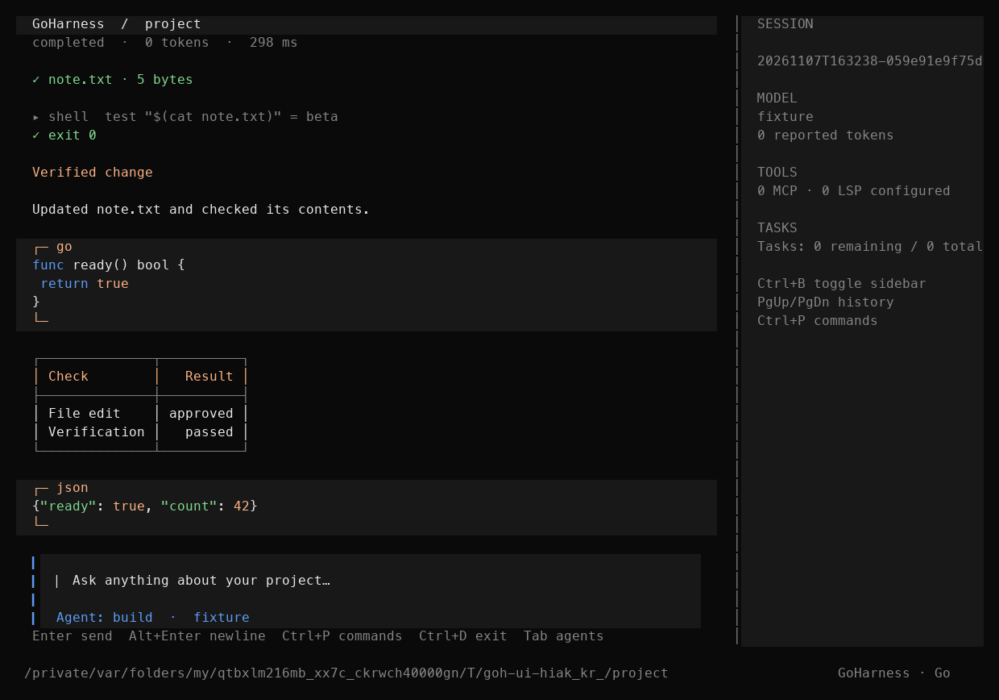
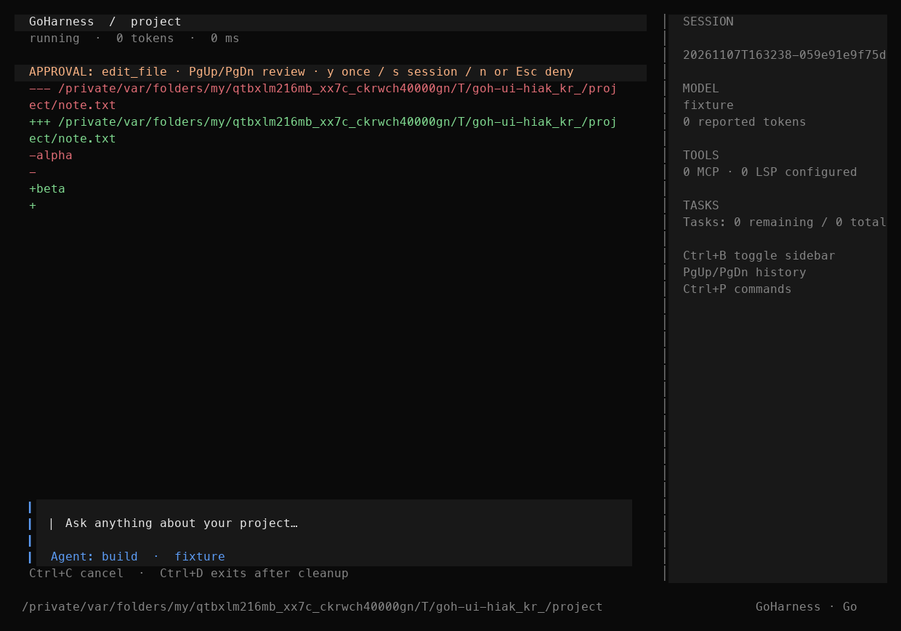
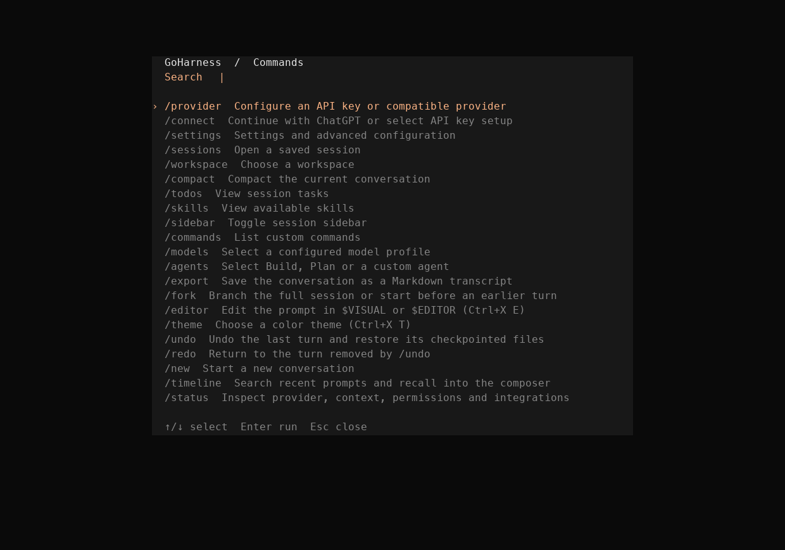
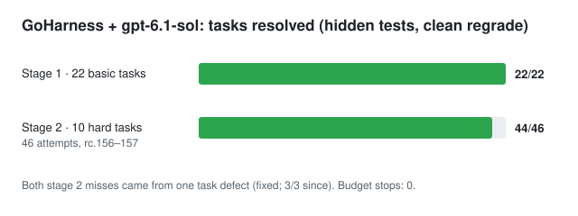

# GoHarness (`goh`)

A local-first coding agent written in Go. One binary provides a terminal UI, a headless CLI for
scripts and benchmarks, a local HTTP API and an ACP adapter for editors. It runs on macOS, Linux
and Windows and works with a ChatGPT sign-in, OpenAI, Anthropic, and any OpenAI-compatible
endpoint.

> **Status:** release candidate (`v1.0.0-rc.*`). No stable release yet.



## Features

- **Verified outcomes.** Every run ends as `verified`, `unverified`, `no_changes` or
  `failed_verification`. An optional `verify` command runs after changes and feeds failures back
  to the model for repair.
- **Enforcement outside the model.** Approvals per tool, command prefix or web origin; an opt-in
  shell sandbox (sandbox-exec on macOS, Landlock on Linux); a filtered child environment; no writes to
  `.git`; private-address blocking for web fetches; hooks that fail closed.
- **Safe edits.** Hash-guarded writes, edits that must match exactly one location, per-edit
  checkpoints and optional whole-project snapshots with undo, redo and restore.
- **Durable sessions.** An fsynced journal with crash recovery, salvage, resume, fork, export and
  rewind. Interrupted tool calls are never replayed automatically.
- **Long-running context.** Old tool output is masked before summarising, user instructions stay
  pinned, and prompt caching is used on OpenAI and Anthropic.
- **Integrations.** Local and remote MCP servers, LSP diagnostics, formatters, skills, custom
  commands, subagents, web fetch and search.
- **Benchmark runner.** `goh-bench` grades runs against hidden tests in a clean copy, detects
  tampering and counts false completions.

| Approval with a diff preview | Command palette |
| --- | --- |
|  |  |

## Install

macOS / Linux:

```sh
curl -fsSL https://github.com/Sanidhya14321/goh/releases/latest/download/install.sh | sh
```

Windows (PowerShell):

```powershell
irm https://github.com/Sanidhya14321/goh/releases/latest/download/install.ps1 | iex
```

The installers verify the binary against `SHA256SUMS` and install to `~/.local/bin` (or
`%LOCALAPPDATA%\Programs\goh`). Set `GOH_VERSION` to pin a release or `GOH_INSTALL_DIR` to change
the destination.

Update with `goh upgrade` (`--check` to only look, `--version TAG` for a specific release).
Remove with `goh uninstall` (lists what it will delete; `--yes` to proceed).

## Quick start

```sh
cd your-project
goh                 # open the terminal UI
```

On first launch `goh` opens a provider picker. Choose one, or press Esc to look around first;
pressing Enter in chat reopens it. Add or switch providers any time with `/connect` and
`/providers`; `/models` picks the model, and the choice is saved.

`goh` opens a project browser where you ran it: open that folder or pick one of its
subfolders or your recent projects (type to filter, or a path like `~/code/app`), trust it once,
and chat starts there. Trusted folders open directly next time.

| Provider | Sign-in |
| --- | --- |
| ChatGPT (Plus, Pro, Team) | Browser OAuth |
| Anthropic, OpenAI, OpenRouter, Google Gemini, Groq | API key, verified before saving |
| Ollama | Local server, no key |
| Custom | Any URL speaking `chat_completions`, `openai_responses` or `anthropic_messages` |

Claude Pro/Max subscriptions cannot be connected; use an Anthropic Console API key.

Headless use:

```sh
goh run fix the failing tests                 # one request, text output
goh run --format json --allow edit_file,shell --prompt 'Fix the tests'
goh resume SESSION_ID --prompt 'Now add a regression test'
```

Headless runs never wait for input. Exit codes: `0` completed, `1` error, `3` needs permission,
`4` needs input, `5` budget exhausted, `130` cancelled.

## Using the terminal UI

| Key / command | Action |
| --- | --- |
| `Ctrl+P` / `Ctrl+K` | Command palette |
| `@path` | Attach a project file reference (fuzzy search, honours `.gitignore`) |
| `!command` | Run a shell command yourself |
| `Enter` / `Alt+Enter` | Send / new line. Enter during a run queues up to five prompts |
| `Esc` / `Ctrl+C` | Cancel the current run |
| `/providers`, `/models`, `/agents` | Switch provider, model, or agent (Build, Plan, custom) |
| `/sessions`, `/new`, `/fork` | Browse, start or branch conversations |
| `/undo`, `/redo` | Take back the last turn, restoring files it changed |
| `/compact`, `/export`, `/timeline` | Summarise context, save a Markdown transcript, browse past prompts |
| `/status` (`Ctrl+G`), `/theme`, `/editor` | Status snapshot, theme picker, edit draft in `$EDITOR` |
| `Ctrl+B` | Toggle the session sidebar |

Approvals: `y` allow once, `s` allow for this session, `n` refuse. Key bindings are configurable;
see the [user guide](docs/USER_GUIDE.md#keyboard-shortcuts).

## Configuration

User configuration lives at `<OS config dir>/independent-harness/config.json` (`goh config` prints
the effective configuration with secrets removed). Precedence, highest first: CLI flags →
`HARNESS_*` environment variables → selected profile → config file → defaults.

A minimal hand-written provider:

```json
{
  "protocol": "chat_completions",
  "base_url": "https://api.example.com/v1",
  "model": "your-model-id",
  "context_window": 128000,
  "api_key_env": "EXAMPLE_API_KEY"
}
```

Commonly used settings:

```jsonc
{
  "sandbox": {"enabled": true, "network": false},
  "verify": {"command": "go test ./...", "repair_attempts": 1},
  "shell_rules": [{"match": "go test *", "action": "allow"}, {"match": "*rm -rf*", "action": "deny"}],
  "file_rules": [{"match": "*.env*", "action": "deny"}],
  "project_snapshots": true,
  "max_run_tokens": 2000000
}
```

`OPENAI_API_KEY` and `ANTHROPIC_API_KEY` are only sent to the official HTTPS hosts. Saved keys
are stored per endpoint with mode `0600`; `goh auth store keychain` seals them with a key held by
the OS keychain, Secret Service or DPAPI.

The [user guide](docs/USER_GUIDE.md) covers every option: providers and failover, permissions,
sandbox, hooks, sessions and recovery, snapshots, MCP, LSP, formatters, skills, agents and
custom commands.

## Interfaces

| Interface | Command | Notes |
| --- | --- | --- |
| Terminal UI | `goh` / `goh chat` | Default |
| Headless CLI | `goh run` | Text or versioned JSON events |
| HTTP API | `goh serve` | Loopback only, bearer token, NDJSON streaming |
| Remote UI | `goh attach` | Terminal UI against a running `goh serve` |
| Editors | `goh acp` | Agent Client Protocol v1 over stdio |

Run `goh --help` for all commands.

## Benchmarks



With `gpt-6.1-sol` over the ChatGPT sign-in, every attempt regraded against hidden tests in a
clean copy: 22/22 basic tasks, 25/26 hard symptom-described tasks, 8/8 compound three-bug tasks
and 14/19 real bug fixes from eight Go libraries. Details and per-run reports are in
[docs/benchmarks](docs/benchmarks/README.md); to run your own, see
[bench/README.md](bench/README.md).

## Building from source

Requires Go 1.27.4 (a pinned toolchain can live at `research/tooling/go`). The resulting binary has
no runtime dependencies.

```sh
make build          # bin/goh and bin/scripted-model (CGO disabled)
make install        # build and copy goh to ~/.local/bin (PREFIX=… to change)
make test           # unit tests; also: race, vet, fuzz
make e2e            # CLI acceptance and terminal suites against the scripted model
make release        # cross-compiled binaries for 6 platforms in dist/
```

[docs/development/TESTING.md](docs/development/TESTING.md) lists the gates a change must pass.

Try it without a real model using the scripted endpoint:

```sh
./bin/scripted-model --scenario text                 # terminal 1
./bin/goh run --config config.example.json --project . --prompt 'Hello' --format json   # terminal 2
```

Releases are published by `.github/workflows/release.yml` when a `v*` tag is pushed.

## Documentation

| Document | Contents |
| --- | --- |
| [User guide](docs/USER_GUIDE.md) | Every feature and setting |
| [Architecture](docs/ARCHITECTURE.md) | Package layout and runtime design |
| [Changelog](CHANGELOG.md) | Release notes |
| [Status](docs/development/STATUS.md) | Known gaps and what is not yet verified |
| [All documentation](docs/README.md) | Benchmarks, testing, design decisions, verification log |

## License

Apache License 2.0 — see [`LICENSE`](LICENSE). Third-party module licenses are in
[`licenses/`](licenses/), summarised in [`THIRD_PARTY_NOTICES`](THIRD_PARTY_NOTICES) and
[`docs/DEPENDENCIES.md`](docs/DEPENDENCIES.md). Benchmark tasks derived from MIT and BSD libraries
are covered in [`bench/licenses/`](bench/licenses/README.md). Provenance:
[`docs/ORIGIN_LEDGER.md`](docs/ORIGIN_LEDGER.md).
