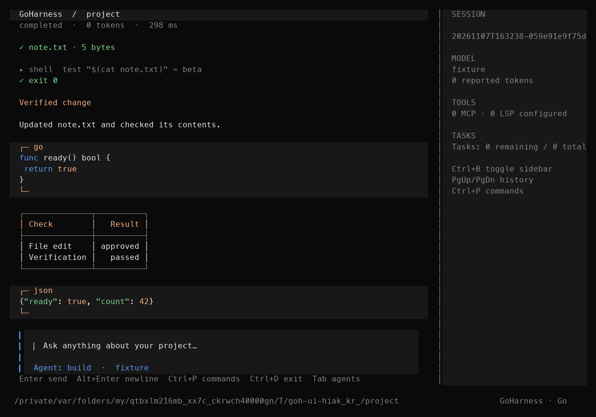
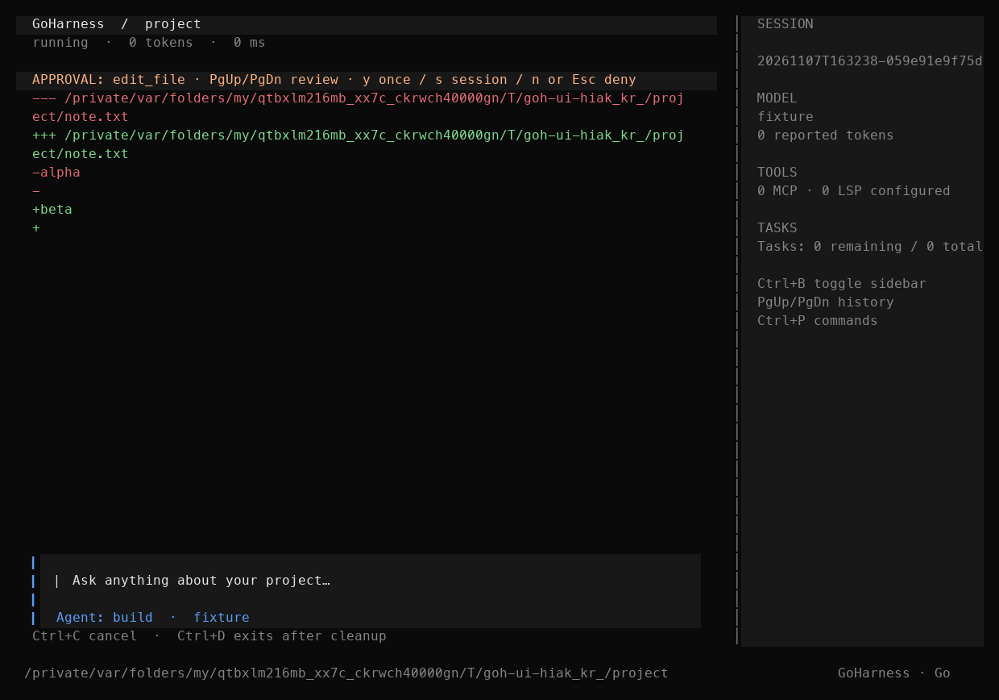
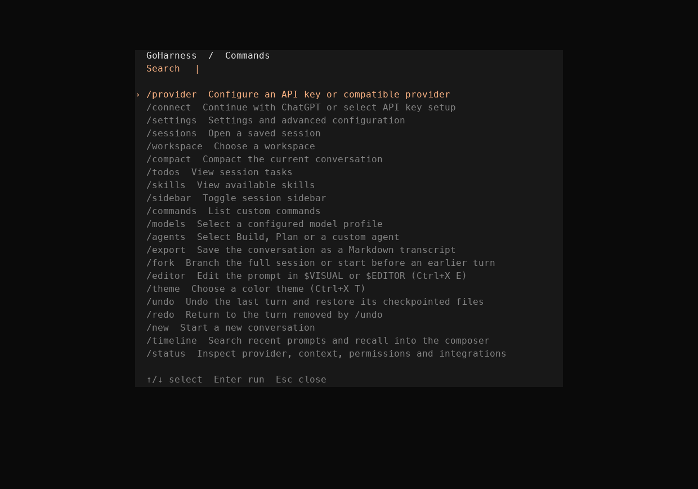
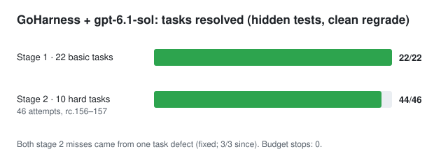

# GoHarness (`goh`)

An original, local-first coding agent written in Go: a terminal UI, a headless CLI for scripts and
benchmarks, an HTTP API and an ACP editor adapter. It runs on macOS, Linux and Windows, works with
the ChatGPT sign-in, OpenAI, Anthropic and any OpenAI-compatible endpoint, and keeps every change
behind local approvals, a shell sandbox and a durable session journal.

This is a development alpha. No release has been published yet; build from source (below).



## Why GoHarness

- **Honest completion.** Every run ends with an outcome (`verified`, `unverified`, `no_changes`,
  `failed_verification`), not just "done". Unchecked changes get one reminder to run a check, and
  checks that pass only against a fake the model wrote itself get one reminder to confirm the real
  definitions. An optional `--verify` command repairs failures before finishing.
- **Enforcement outside the model.** Approvals scoped to a command prefix or web origin, a shell
  sandbox (sandbox-exec on macOS, Landlock on Linux), a filtered child environment, no writes to
  `.git`, private-address blocking for web fetches, and hooks that fail closed and can never grant.
- **Exact, safe edits.** Hash-guarded file writes, whitespace-tolerant edits that must match exactly
  one place, and whole-project snapshots you can list and restore.
- **Durable sessions.** An fsynced journal, salvage of damaged journals, resume, fork, undo/redo and
  rewind. A dropped model stream is never replayed and no uncertain tool is re-run; an opt-in
  `--retry-interrupted` re-sends only the request.
- **Context that lasts.** Old tool results are masked (the last 10 kept in full) before anything is
  summarised, your instructions are pinned verbatim, and prompt caching is used on OpenAI and
  Anthropic.
- **A built-in benchmark runner** (`goh-bench`) with hidden tests, clean regrading, tamper detection,
  false-completion counts and A/B arms.

| Approval with a diff preview | Command palette |
| --- | --- |
|  |  |

## Benchmark results (verified)



Model `gpt-6.1-sol` over the ChatGPT sign-in. Every attempt is graded in a clean copy of the task with
hidden tests, so a run passes only if the real tests pass, whatever the model reported.

| Run | Harness | Tasks | Attempts | Resolved | False completions | Avg tool calls | Avg time |
| --- | --- | --- | --- | --- | --- | --- | --- |
| Stage 1 | rc.156 | 22 basic (Go, Python) | 22 | **22 (100%)** | 0 | 6.0 | 42 s |
| Stage 2 | rc.156 | 10 hard, symptom-described | 26 | **25 (96%)** | 1 | 8.7 | 59 s |
| Stage 2 A/B | rc.157 | same 10 hard | 20 | **19 (95%)** | 1 | 10.2 | 64 s |
| Task fix rerun | rc.158 | `hard-py-double-charge` (fixed) | 3 | **3 (100%)** | 0 | 11.7 | 98 s |

- Both false completions came from one task, `hard-py-double-charge`, and the cause was a defect in
  that task: its hidden test called a gateway `lookup()` method that nothing in the repository
  mentioned, so the model had to guess an interface (`idempotency_key`, `is_charged`). With the
  interface documented in the task, the model solved it 3 of 3. Excluding that task's earlier
  attempts, the hard set stands at 42/42.
- Turning the completion reminder off made no difference: it never fired, because the model always
  ran its own tests.
- Runs cut off by the ChatGPT plan's usage limit are excluded, not counted as failures.

Full reports: [`docs/bench/`](docs/bench/). How to run your own: [`bench/README.md`](bench/README.md).
Architecture: [`docs/ARCHITECTURE.md`](docs/ARCHITECTURE.md).

## Reference

The rest of this file is the full reference: install, configuration, permissions, sessions,
integrations and interfaces.

## Install

macOS or Linux:

```sh
curl -fsSL https://github.com/Sanidhya14321/goh/releases/latest/download/install.sh | sh
```

Windows (PowerShell):

```powershell
irm https://github.com/Sanidhya14321/goh/releases/latest/download/install.ps1 | iex
```

Both scripts download the binary for your platform with `SHA256SUMS`, refuse to
install on a missing, duplicated or mismatched checksum, and install to
`~/.local/bin` (or `%LOCALAPPDATA%\Programs\goh`). Set `GOH_VERSION` to pin a
release tag or `GOH_INSTALL_DIR` to choose the destination. These URLs work once
a release is published; no V1 release has been published yet.

## Build and try locally

With `goh` on your PATH, run `goh` to open chat or `goh --help` for CLI
commands. The local zsh setup also maps bare `go` to chat.

Chat opens before provider setup. If configuration is incomplete, it displays
the problem and blocks prompt submission. Press **Ctrl+P** for the searchable
command palette, or type `/provider` to configure your API URL, model, context window, and optional
API key. Use **Tab** to move between fields and **Ctrl+S** to save and return
to chat. Invalid credentials produce an error in chat with a link to provider
setup. Fixing the key retains the session.

Use `/workspace` to choose a project, `/sessions` to select a saved chat, and
`/settings` for the settings menu. Closing a settings panel returns to chat.

Type `@` at the start of a word in the composer to search project files. The
menu matches filenames and relative paths, including fuzzy abbreviations.
Use ↑/↓ to select and Tab or Enter to insert the path. Paths containing spaces
are quoted automatically. Esc dismisses the menu and leaves your draft intact.
The prompt carries the path as text. The agent can read it through its usual
file tools.

The first search indexes names in the background. A snapshot is reused for
15 seconds, and is marked stale when an agent run finishes. A stale snapshot
still answers immediately while a background rescan replaces it.
`.gitignore` files are honored, including nested files, negation (`!`),
directory-only rules, anchored patterns and `**`; ignored directories are not
scanned. It shows up to ten results from a scan of up to 12,000
entries and 24 directory levels. The scan skips dot-prefixed entries, symlinks,
`node_modules`, and `vendor`. It uses the session project, or the current
directory while chat is waiting for provider setup.

`/timeline` or Ctrl+T opens a searchable list of up to 200 recent prompts while
idle. Enter opens a multiline preview; arrows, PgUp/PgDn, and Home/End scroll it.
Ctrl+R replaces the composer with the selected prompt for editing. Send it with
Enter only when ready. Esc returns to the list and then to chat, preserving the
original draft unless recall was explicitly chosen. Ctrl+C or Ctrl+D dismisses
the dialog. The palette also lists /timeline.

This list uses the same bounded history as composer recall, newest first, with
consecutive duplicates collapsed. On resume it is seeded from retained runtime
history; prompts removed by context compaction are outside this view. Browsing
performs no journal reads or writes and makes no provider request. Preview rows
are cached until the selection or viewport width changes.

Use `/fork` or search **Fork session** in the command palette to branch the
current conversation. Choose **Full session** to copy the conversation through
its latest turn, or search up to 200 recent journal prompts and choose a turn
to branch immediately before it. The selected prompt opens in the new composer
for editing. The branch shares the workspace on disk, so its files reflect
the current workspace. Conversation state is copied without session grants
or tool execution.

### Themes

`/theme` or **Ctrl+X T** opens the theme picker: `dark` (default), `light` and
`high-contrast`. A choice applies to the current session; set `"theme"` in
the configuration to keep it. Unknown names are rejected when the
configuration loads. Themes select from a fixed built-in palette, so no
configured value is written to the terminal as an escape sequence.
`NO_COLOR` still disables color entirely.

### Shortcuts

Chat-level shortcuts can be changed with `keybinds` in the configuration.
Values are comma-separated keys; `<leader>x` means the leader key, then `x`;
`none` removes a binding.

```json
{"keybinds": {"leader": "ctrl+o", "command_palette": "ctrl+p,f1", "editor_open": "<leader>e", "sidebar_toggle": "none"}}
```

Actions and defaults: `leader` (`ctrl+x`), `command_palette` (`ctrl+p,ctrl+k`),
`sidebar_toggle` (`ctrl+b`), `timeline` (`ctrl+t`), `status` (`ctrl+g`) and
`editor_open` (`<leader>e`), `theme_list` (`<leader>t`).

Transcript navigation: `messages_first` (`<leader>g`), `messages_last`
(`ctrl+alt+g`), `messages_previous` / `messages_next` user turn
(`<leader>k` / `<leader>j`), `messages_half_page_up` / `messages_half_page_down`
(`ctrl+alt+u` / `ctrl+alt+d`), `messages_copy` (`<leader>y`, copies the last
assistant reply as Markdown through the terminal clipboard, OSC 52), and
`suspend` (`ctrl+z`), `messages_undo` / `messages_redo` (`<leader>u` / `<leader>r`, the same as
`/undo` and `/redo`). PgUp/PgDn still scroll half a page. Unknown actions, malformed keys, a key bound to two
actions, and keys the composer and approvals rely on (Enter, Esc, Tab, arrows,
Ctrl+C, Ctrl+D and the editing keys) are rejected when the configuration loads.
Pressing the leader shows the available follow-up keys.

Press **Ctrl+X** then **E**, or use `/editor`, to edit the current draft in
`$VISUAL` (or `$EDITOR`). The chat suspends while the editor runs in the
workspace directory, then loads the saved text into the composer. A single
trailing newline on a one-line prompt is dropped. If the editor exits with an
error or saves an empty file, the original draft is kept. Values such as
`code --wait` are split into arguments; no shell is invoked. The draft is
not sent until you press Enter.

Use `/undo` to take back the last turn. GoHarness restores the files that
turn changed through built-in file tools, newest change first, then continues
in a branch that ends before that turn and puts its prompt back in the
composer. `/redo` (or **Redo** in the palette) reapplies those files and returns
to the original conversation. Redo is available until you send a new prompt
from the branch; after that the original conversation stays in `/sessions`.
The original journal is never edited.

File restoration uses checkpoints, which are on by default in best-effort
mode: if a checkpoint cannot be saved (for example storage limits), the edit
still happens and undo lists it as not restorable. `"snapshots": true` or
`--snapshots` makes them strict (an edit that cannot be checkpointed is
refused); `"snapshots": false` turns them off.
Without them, `/undo` still rewinds the conversation, and the notice lists the
tools whose effects remain. Shell commands, MCP tools and any other effect without
a checkpoint are never reverted; the notice names them. Every file's current
hash is checked before anything is restored. If a file was changed outside
GoHarness, undo refuses and puts back anything it had already reverted, so files
and conversation stay consistent. `/undo` waits for an active run to finish or be
cancelled. The same operations are available as
`goh changes undo-turn SESSION` and `goh changes redo-turn SESSION`, which
print the result as JSON.

In `/sessions`, **Ctrl+R** renames the selected session (an empty title
restores the default taken from the first prompt) and **Ctrl+D**, pressed
twice, moves it to the trash. Deleting moves the journal, title, artifacts and
file checkpoints into a `trash` folder in session storage; nothing is erased.
`goh sessions restore ID` brings it back and refuses to overwrite anything. A
session open in any running GoHarness, including the current one, cannot be
deleted. The CLI equivalents are `goh sessions rename ID TITLE`,
`goh sessions delete ID` and `goh sessions restore ID`. Titles are stored in a
private sidecar file, cleaned of control characters and limited to 120
characters; the journal itself is never edited.

If a session journal is damaged (not just cut off by a crash, which is
repaired automatically), GoHarness refuses to open it and says so.
`goh sessions salvage ID` copies the readable conversation before the damage
into a new session. Like `/fork`, it never replays tools or carries permission
grants, and it drops an incomplete tool call at the cut. The damaged file is
left unchanged for inspection. `goh sessions list` and `/sessions` keep showing
healthy sessions; journals with a damaged header are reported on stderr with
the salvage command. Damage past the header is reported when the session is
opened.

Use `/export` or search **export** in the command palette to save a
Markdown transcript of the current chat. Edit the filename, then press Enter.
Tab focuses **Include tool details**, and Space toggles it. Relative paths
start at the session workspace. The export is a new private file. Existing
destinations are rejected so you can choose another name.

Markdown includes durable user and assistant messages, including older turns
outside active context. Tool arguments and results are optional and off by
default. Exported content can include sensitive text. The journal and provider
settings stay outside the export flow.

Use `/connect` to choose **Continue with ChatGPT** or API key setup. The
ChatGPT option opens the official OpenAI authorization page and then loads the
account's available models. `/models` uses that catalog while connected to
ChatGPT. A saved model can open chat when the catalog is temporarily unavailable.
On an unconfigured install, an authorized account with a saved model becomes
the default for bare `goh`. Existing configured providers keep their default.

The same connection is available in the CLI:

```sh
goh auth login
goh auth status
goh auth models
goh chat --protocol openai_chatgpt
```

Use `goh auth logout` to revoke the saved authorization and clear the local
credentials. GoHarness keeps one ChatGPT authorization on this host. Reopen
`/connect` and select **Reauthorize ChatGPT** if renewal fails. The
`openai_chatgpt` protocol is bound to OpenAI's official Responses endpoint
and uses GoHarness's private OAuth store. For a Responses API key, select
`openai_responses` instead and configure the URL and key as usual.

Live smoke verification in a disposable project is available with
`python3 scripts/test_openai_live.py --binary bin/goh`. It uses the saved
ChatGPT authorization and makes real inference requests.

You can keep typing while the agent works. Enter queues the draft (up to
five prompts; the footer shows the count) and each queued prompt is sent in
order after the current run **completes**. If a run fails, is cancelled, or
stops for approval or a question, nothing is sent: the queued prompts return
to the composer as an editable draft. Slash commands are not queued, and
palette or dialog shortcuts wait until the run ends.

During a run, Esc or Ctrl+C requests cancellation. While idle, use the
palette to open provider setup or model selection and retain the draft.
After transient provider failures, Up recalls the previous prompt and
`/models` lets you select a configured profile.

`OPENAI_API_KEY` and `ANTHROPIC_API_KEY` are reserved for their official HTTPS
hosts. For a compatible gateway, save a key in `/provider` or configure its
own environment variable with `api_key_env`. A route change clears an
inherited gateway variable, so a profile for a different endpoint should
specify its own. The Chat Completions client accepts a complete JSON reply and
retries once without optional stream options if the endpoint explicitly rejects
that field before returning content.

See [the end-to-end audit](docs/END_TO_END_AUDIT.md) for tested recovery paths,
ChatGPT account connection status, and remaining gaps.

`/status` or Ctrl+G opens a local status snapshot while idle. It shows provider
configuration, credential presence, context/output budgets, reported usage,
session grants, configured MCP/LSP servers, and formatter executable availability.
Integration entries describe configuration rather than live connection health.
Provider URL paths, query strings, key values, and integration environments are
excluded from this snapshot.

Use arrows or PgUp/PgDn to scroll, Home/End to jump, and r to refresh. The p/m/a/s
shortcuts open provider, model, agent, and advanced settings respectively.
Esc returns to chat and preserves an unfinished draft opened with Ctrl+G.

The session browser shows recently created conversations first and derives titles
from their first saved user message. Search matches titles, IDs, and workspace
paths. Ctrl+W toggles the current-workspace filter. Summaries load in background
batches while the browser accepts input. Wide terminals show a preview pane;
Tab switches between the list and a full-width preview. PgUp/PgDn scroll the
preview. Esc returns to the current conversation.

Previews display complete records from the first 64 KiB and label partial views.
For large journals, their status and excerpts describe that prefix. The CLI
equivalent is `goh sessions preview ID --session-dir DIR`. Preview reads work
while another process owns the journal writer lock.

`/models` opens a searchable list of configured model profiles and a provider
setup entry. `/agents` selects Build, Plan, or a configured custom agent.
Tab/Shift+Tab cycle agents when the composer is empty. These switches retain the
session and re-create the runtime through the existing configuration resolver.
Plan mode exposes read-only tools. `/new` starts a fresh conversation in the
current workspace with the selected model and agent.

Selections apply to the current chat process. Set the default `profile` and
`agent` in advanced settings to use them in future processes. Environment and
explicit CLI provider overrides follow the documented configuration precedence.

The terminal UI uses a centered welcome screen and prompt panel, a bottom
workspace bar, and an optional session sidebar on terminals at least 112 columns
wide. **Ctrl+B** toggles the sidebar. **PgUp/PgDn** scroll the transcript.
Permission previews keep their own scrolling and explicit approval controls.
**Ctrl+K**, `/help`, and `/palette` also open the command palette.
`NO_COLOR` enables plain rendering. Smaller terminals use a compact layout.
**Ctrl+L** redraws the terminal screen.

The composer supports Left/Right, Home/End, Delete, Ctrl+A/Ctrl+E for line
boundaries, Ctrl+W to delete the preceding word, and Ctrl+U to clear a draft.
Up/Down move through multiline input, then recall prompt history at the first
or last line. Returning past the newest history entry restores the draft.
Type a slash-command prefix and press Tab to complete it. Configured custom
commands appear in both suggestions and the searchable command palette.

Conversation rendering supports headings, lists, quotes, paired emphasis
markers, fenced code panels, and pipe tables with column alignment and wrapping.
Narrow panes stack table columns under their headers. Go, JSON/JSONC,
JavaScript/JSX, and TypeScript/TSX code fences receive lexical highlighting.
Other languages retain plain code panels. Code text and approval previews retain
their literal contents. Links remain plain text.

The key field is masked. Saved keys live in separate user configuration files
with mode `0600`, scoped to the exact request URL and protocol. HTTPS and local
loopback URLs support saved keys. Choose a workspace folder inside your home
directory so the agent's project scope stays separate from the credentials.
An environment key, if set, takes precedence.
Leave the key field blank to keep a saved key or enter `REMOVE` to delete it.

In the settings menu, press **s** to edit the full user JSON configuration. This
includes profiles, roles, integrations, and other file settings. Press **r**
to run a GoHarness CLI operation by entering its arguments as a JSON array,
such as `["sessions", "list"]`. The menu passes arguments directly to
GoHarness. `goh setup` opens the provider form directly.

Go 1.27.3 is pinned. Build requires Go and network access for pinned modules;
the resulting `goh` binary requires neither Go, Node, Bun, nor REA.
From this directory:

```sh
make GO=../research/tooling/go/bin/go build
./bin/scripted-model --scenario text
```

In a second terminal, from this directory:

```sh
./bin/goh run --config config.example.json --project . --prompt 'Hello' --format json
./bin/goh chat --config config.example.json --project .
```

The scripted service binds loopback and uses no live model or credentials. Available
scenarios: `text`, `multi`, `edit`, `deny`, `shell`, `drop`, `malformed`, `http-error`,
`delay`, `missing-usage`. Use `--script FILE` for a JSON array of response steps
with `text`, `calls`, `raw`, `status`, `drop`, `delay_ms`, and `usage` fields.
For `edit`, prepare a disposable project with `note.txt` containing `alpha` plus
newline, then run with `--allow edit_file,shell`. It reads, edits to `beta`, and runs
a real shell assertion. Without the grant, the headless run exits for permission.
Stop the fixture with Ctrl+C when done.

## Configuration and commands

Copy `config.example.json` to an explicit user configuration. Set the exact model
ID and its context window. Set `base_url` to the provider's API base, including
any prefix such as `/v1`. The harness appends `/chat/completions` or `/messages`
according to the selected protocol. For a custom route or URL with query
parameters, set `endpoint` to the full request URL. Use one address per layer.

Set the API key in the environment variable named by `api_key_env` (or the
protocol default). The harness sends the key as a bearer token for Chat
Completions or as `x-api-key` for Anthropic Messages. A local server can accept
requests without a key. Actual credential values are never serialized from
configuration into normal logs or journals.
Prompts and tool output may themselves contain sensitive project data.

Precedence: CLI flags (`--base-url`, `--endpoint`, `--api-key-env`, etc.)
→ environment (`HARNESS_BASE_URL`, `HARNESS_ENDPOINT`, `HARNESS_MODEL`,
`HARNESS_API_KEY_ENV`, `HARNESS_CONTEXT_WINDOW`, `HARNESS_SESSION_DIR`)
→ selected model profile → JSON configuration (or OS user config directory
`independent-harness/config.json`)
→ defaults. macOS user config directory is usually `~/Library/Application Support`;
Linux follows `$XDG_CONFIG_HOME` or `~/.config`. A model and context window are
required. `endpoint` is the complete URL, including `/v1/chat/completions`.
`output_parameter` accepts `max_tokens`, `max_completion_tokens`, or empty to omit.
No optional temperature or reasoning parameters are sent.

```text
goh run --project DIR --prompt TEXT --format text|json [--config FILE]
goh chat --project DIR [--session ID] [--config FILE]
goh resume ID --prompt TEXT [--config FILE]
goh sessions list [--session-dir DIR]
goh sessions show ID [--session-dir DIR]
goh doctor
goh version
```

`chat` offers a session chooser when saved sessions exist. Enter submits;
Alt+Enter or Ctrl+J adds a line; paste supports multiple lines. Ctrl+C interrupts
an active run and leaves the UI open. Ctrl+D exits when idle. The TUI displays
streaming text, tool results, approval previews, model, timing, and provider usage.
Resize only changes rendering. Streaming deltas are provisional until the
`assistant_completed` event; journals retain completed messages, not every delta.
The compact viewport shows recent output; inspect the journal for full history.

## Permissions and file behavior

Project listing, reading and regex searching are automatic. File mutations, shell
commands, MCP server starts, and MCP calls require authorization. In the TUI,
PgUp/PgDn scrolls the approval preview. `y` allows once, `s` grants that tool for this process, and `n` refuses. Approval
previews show actual paths, before/after text, or command/cwd/timeout. Large diff
previews explicitly mark truncation; use smaller edits for complete review.
Repository `AGENTS.md` is untrusted guidance and cannot grant authority.

Headless mode never waits for unavailable input: it emits `needs_permission` and
exits 3. Supply explicit comma-separated run grants, for example
`--allow edit_file,shell`. MCP grants are `mcp_start:SERVER` and
`mcp__SERVER__TOOL`. Grants cover any valid arguments to those named tools for the
current process; they expire on exit and are never restored by resumption.
Exit codes: 0 completed, 3 needs permission, 130 cancelled, 1 other failures.
JSON stdout contains only versioned events; diagnostics go to stderr.

Built-ins: `list_files`, `read_file`, `search`, `create_file`, `write_file`,
`edit_file`, `shell`. Tools publish schemas to the configured model. File operations
reject absolute/escaping paths, symlinks, special files and binary/non-UTF-8 text.
Reads provide full-file SHA-256. Existing-file writes and edits require
`expected_sha256`. Edits match exact `old_text` once unless `replace_all` is true;
ambiguous and stale edits fail without publication. CRLF and unaffected bytes
are preserved. Existing modes survive replacement; new-file publication never
overwrites an existing path. There is no multi-file transaction or universal
compare-and-swap against external programs. See `internal/tools/README.md` for limits.

Approved shell commands run `/bin/sh -c` in the project or validated relative cwd.
Commands are not sandboxed. Stdout/stderr drain concurrently, retaining a bounded
preview and a private output artifact (1 MiB). Cancellation and timeouts terminate
the owned process group, allow two seconds, then escalate. Deliberately detached
processes are outside the guarantee. Effects are not rolled back.

### Shell command rules

Shell commands, background jobs, formatters and MCP/LSP servers do **not**
inherit your whole environment. They receive a safe set (PATH, HOME, user,
shell, terminal, locale `LC_*`, `XDG_*`, temp folders, toolchain locations such
as `GOPATH`, `JAVA_HOME`, `VIRTUAL_ENV`, and the Windows system variables), so
API keys, tokens and cloud credentials in your shell cannot be read by a
command the model runs. Proxy settings are withheld too, since their URLs can
hold passwords. List anything else a command needs:

```json
"env_passthrough": ["DATABASE_URL", "MYAPP_*", "HTTPS_PROXY"]
```

`NAME_*` passes every variable with that prefix. A lone `"*"` restores the old
behaviour of passing everything. An MCP or LSP server's own `env` settings are
always added.

With the `anthropic_messages` protocol, GoHarness marks prompt-cache
breakpoints so each turn re-reads the conversation from Anthropic's cache.
Set `"disable_prompt_cache": true` if a gateway rejects `cache_control`.

### Whole-project snapshots

File checkpoints cover edits made through GoHarness's own tools. To also undo
what shell commands change (installs, code generators, `sed -i`), turn on:

```json
"project_snapshots": true
```

GoHarness then records the whole project at the start and end of every run in
a private shadow Git repository beside the session folder. Files in
`.gitignore` are skipped, and your own `.git`, index, branches and commits are
never touched. Snapshots need `git` on PATH; a failed snapshot is reported and
never stops a run.

```sh
goh snapshots list SESSION           # files each run changed
goh snapshots diff SESSION 2         # full diff of run 2
goh snapshots restore SESSION 2      # list what returning to before run 2 changes
goh snapshots restore SESSION 2 --yes
goh snapshots undo SESSION --yes     # put back the state before the last restore
```

### Reasoning effort and thinking

`"reasoning_effort"` steers how hard the model thinks (`/effort` changes it
for one session). OpenAI protocols accept `none`, `minimal`, `low`, `medium`,
`high` and `xhigh`; Anthropic accepts `low`, `medium`, `high`, `xhigh` and
`max` (sent as `output_config.effort`). Which levels a model supports is
checked by the provider.

For current Claude models set `"anthropic_thinking": "adaptive"` (the model
decides how much to think; summaries of its reasoning stream to the UI). Older
Claude models use a fixed `"thinking_budget"` instead. Thinking blocks are
always passed back unchanged during tool use.

Repository guidance (`AGENTS.md`, or `CLAUDE.md`) is sent as a separate,
clearly labelled untrusted message, not as part of the system prompt; your
own guidance file beside the config stays in the system prompt.

### Verify and repair

Give GoHarness your own acceptance check, and it runs it after any run that
changed files:

```json
"verify": {"command": "go test ./...", "repair_attempts": 1, "timeout_seconds": 300}
```

If the check fails, its output is handed back to the model to fix, at most
`repair_attempts` times (default 1, at most 3). The run's `outcome` is then
`verified`, or `failed_verification` when the check still fails. The check
is your own command, so it runs without an approval prompt (inside the
sandbox when that is on). `"max_tool_calls": N` caps the tool calls in one
run and `"max_run_seconds": N` its wall time; child tasks count against the
same budgets. Hitting either ends the run as `budget_exhausted`.

### Shell sandbox

Approval decides *whether* a command runs; the sandbox limits *what it can do*
once it runs. It applies to shell commands, `!commands`, background jobs and
formatters (not to MCP/LSP servers or hooks, which you configure yourself).

```json
"sandbox": {"enabled": true, "network": false, "writable": ["~/Library/Caches/go-build"]}
```

- Writes are allowed only in the project, temporary folders and `writable`
  paths (absolute or `~/…`). Build tools that write to a cache in your home
  folder need that cache listed.
- GoHarness's own config, credentials and session folders cannot be read.
- On macOS, files your `file_rules` deny cannot be read by commands either.
  Linux (Landlock) cannot hide a single file inside the writable project, so
  there deny rules cover GoHarness's own tools but not shell commands.
- `"network": false` (the default) blocks network access; set it to `true`
  for commands that download dependencies.
- macOS uses the built-in `sandbox-exec`. Linux uses Landlock (Linux 5.13+;
  blocking the network needs 6.7+). On Linux, folders on the way to the
  protected ones can be entered but not listed.
- Where no sandbox is available (Windows, or Linux without Landlock),
  commands are **refused**, never run unconfined. Turn the sandbox off to
  run them.

`webfetch` only connects to public internet addresses. Loopback, private
networks and link-local addresses (including cloud metadata at
169.254.169.254) are refused unless you set `"webfetch_allow_private": true`.
A `file_rules` entry with `"action": "deny"` hides matching files from reads,
searches, listings and `@` attachments as well as edits. Nothing may write
inside a `.git` folder.

### Hooks

Hooks run your own commands at points in the agent loop. They are read only
from your user configuration, never from repository files.

```json
"hooks": [
  {"event": "pre_tool", "tools": ["shell"], "command": "/Users/me/bin/guard-shell"},
  {"event": "post_tool", "tools": ["edit_file", "apply_patch"], "command": "/Users/me/bin/lint-changed", "timeout_seconds": 30},
  {"event": "run_finished", "command": "/Users/me/bin/notify"}
]
```

- The command runs directly (no shell) in the project folder, with the same
  filtered environment as tools plus `GOH_EVENT`, `GOH_TOOL`,
  `GOH_SESSION_ID` and `GOH_PROJECT`. A JSON payload (`event`, `tool`,
  `arguments`, and for `post_tool` the `result`) arrives on stdin.
- `pre_tool` runs **after** you approve a tool and before it runs. Exit 0
  lets it continue; exit 2 refuses it and stderr is shown to the model. Any
  other exit, or a timeout, also refuses it (hooks fail closed). A hook can
  never approve a tool you have not approved.
- `post_tool`: exit 2 attaches the hook's output to the result as
  `hook_feedback` (useful for linters); other exits are only reported.
- `run_finished` is told the final status; it cannot change it.
- `tools` takes names or patterns such as `mcp_*`; leave it out to match
  every tool. The default timeout is 10 seconds (at most 120).

`shell_rules` lets you skip the prompt for commands you trust and refuse
ones you never want run. Each rule has a `match` pattern (`*` matches any
text) and an `action`: `allow`, `deny` or `ask`. The last matching rule
wins. Rules apply to `shell` and `job_start`, for subagents too; commands
you type yourself with `!` are not filtered.

```jsonc
"shell_rules": [
  {"match": "git status*", "action": "allow"},
  {"match": "go test *",   "action": "allow"},
  {"match": "*rm -rf*",    "action": "deny"},
  {"match": "git push*",   "action": "ask"}   // ask even if shell is approved for the session
]
```

- `allow` only covers simple commands. A command containing `;`, `&`, `|`,
  backticks, `$(`, redirects or a newline is never auto-allowed, so
  `git status; rm -rf ~` still needs your approval.
- `deny` is checked against the whole command and every part of a compound
  command.
- Patterns match text, not intent. `rm *` does not catch `FOO=1 rm -rf x`
  or `/bin/rm`; prefer patterns like `*rm -rf*`. Treat deny rules as a
  guardrail, not a sandbox.

### File edit rules

`file_rules` works like `shell_rules` for edits (`create_file`,
`write_file`, `edit_file`, `apply_patch`, including subagents). Patterns
match project-relative paths with `/`; `*` matches any text.

```jsonc
"file_rules": [
  {"match": "*.env*",    "action": "deny"},   // never edit secrets files
  {"match": "*_test.go", "action": "allow"},  // edit tests without asking
  {"match": "go.mod",    "action": "ask"}     // always ask, even if edits are approved
]
```

A patch is denied if any file it touches is denied, and auto-allowed only
when every file is allowed.

## Sessions, recovery and context

Default storage is `~/.local/state/independent-harness/sessions` (override with
configuration, `HARNESS_SESSION_DIR`, or `--session-dir`). Journals are private,
versioned JSONL with an exclusive writer lock. Tool starts are synced before
execution; results and completed messages are synced before being committed.
A final incomplete record is truncated to its valid prefix on recovery; internal
corruption and unknown versions fail explicitly. Session `show` obtains the writer
lock and can recover a truncated tail; it refuses a concurrently active session.

An interrupted tool, MCP startup, disconnect, or timed-out command can leave
uncertain effects. Inspect the journal, files, retained command output and any
external effects before `resume ID --acknowledge-uncertain --prompt TEXT ...`.
Acknowledgment records your decision; no operation is replayed automatically.
Permissions must be reacquired. Missing model tool results are explicitly filled
with interrupted-result messages to preserve provider call/result relationships.

Context estimation conservatively counts one token per UTF-8 byte, including tool
schemas. Output and tool reserves are held back. Basic compaction uses an original
summarization prompt, preserves the active request, the two most recent assistant/
tool groups, and unresolved calls. Original journal records remain available.
If the preserved state or a failed/ineffective summary cannot fit, the run stops
with `budget_exhausted`; it never silently discards the active request.

## Local MCP

Definitions come only from explicit user configuration, for example:

```json
{"mcp":{"local":{"command":"/absolute/path/to/server","args":[],"env":{}}}}
```

Use an existing trusted local stdio server. The harness never installs servers.
Initialization/discovery use the official Go SDK with sampling, elicitation and
multi-round-trip replay disabled. Each server start and call requires permission.
Tools are namespaced `mcp__local__tool`, schemas are compiled before admission,
and all JSON Schema references are rejected (inline the schema). No schema network
fetches occur. Server/tool name parts accept letters, digits, underscores and
hyphens without double underscores, with a 64-byte combined name limit.

Limits: 128 tools/server, 1 MiB protocol frames, 64 KiB call arguments and results,
15-second initialization/discovery, 60-second calls. A cancellation or disconnect
reports uncertainty, terminates that server's owned process group, and never
retries a call. Servers close before the run's terminal event; a new run starts
fresh servers, with session grants reusable within the TUI process. Remote
transports, OAuth, sampling and automatic installation are deferred.

### Remote MCP servers

A server with `url` instead of `command` is reached over MCP Streamable
HTTP. Put tokens in environment variables and name them with `headers_env`:

```jsonc
"mcp": {
  "docs": {"url": "https://mcp.example.com/mcp", "headers_env": {"Authorization": "DOCS_MCP_TOKEN"}}
}
```

Only `https` URLs are accepted (plain `http` only for localhost), redirects
are refused, and the start approval shows the URL and header names but never
header values. Starting a remote server still needs approval, like a local one.

### Web search

Set `websearch_url` to a SearXNG-compatible service (for example a
self-hosted SearXNG with JSON output enabled) to give the agent a
`websearch` tool. Each search needs approval, results are titles, links and
short snippets, and `webfetch` reads a chosen page. HTTPS only (HTTP for
localhost), no redirects. Without `websearch_url` there is no search tool.

## Verify and package

```sh
make GO=../research/tooling/go/bin/go test race vet fuzz acceptance
make GO=../research/tooling/go/bin/go VERSION=0.1.0-dev release
```

Release preparation builds four CGO-free binaries under `dist/`, with checksums,
build metadata and dependency notices. It performs no remote publication.
Cross-compilation does not prove runtime correctness. See `VERIFICATION.md` and
`../specs/COMPATIBILITY_MATRIX.md` for actual coverage, gaps and reference evidence.
Original code, prompts and documentation are Apache-2.0; dependency terms are
preserved in `licenses/` and `THIRD_PARTY_NOTICES`. See `../ORIGIN_LEDGER.md`.

## Reconstructed features beyond the initial alpha

The full pinned OpenCode repository is available for research, including both
runtime families and the web/desktop/server/SDK/integration packages. See
`../research/FEATURE_BACKLOG.md` for repository-wide coverage and pending work.
Source discovery alone does not establish runtime parity.

New built-ins:

- `glob {"pattern":"**/*.{go,ts}","path":"src"}` finds up to 100 files using
  recursive globs, braces and character classes. Results are deterministic,
  project-relative paths. Existing filesystem exclusions and root safety apply.
- `grep {"pattern":"(?i)parser","path":"src","include":"*.go"}` returns up
  to100 matching lines with file paths and line numbers. A file path restricts
  the Go search to that file. Go regex syntax applies. This intentionally differs
  from the shipped reference's file-path-as-parent-directory behavior.
- `todowrite` accepts `{"todos":[{"content":"Verify parser","status":"in_progress","priority":"high"}]}` replaces the session's ordered task list. Status and
  priority are strings, with duplicates and multiple active entries accepted.
  Each update requires permission (`--allow todowrite` for headless runs).
  Limits: 1,000 tasks and 60 KiB serialized state. An empty array clears the list.
  Task state persists through resume, forks, imports and compaction; it grants no
  authority for other tools. TUI displays a task overview; `/todos` or `/tasks`
  lists the current tasks locally, without a model call.

Session management:

```sh
goh sessions export SESSION_ID --output new-session.json --session-dir DIR
goh sessions export SESSION_ID --format markdown --output transcript.md --session-dir DIR
goh sessions import new-session.json --project EXISTING_PROJECT --session-dir DIR
goh sessions fork SESSION_ID --session-dir DIR
goh sessions fork SESSION_ID --before-turn 4 --session-dir DIR
goh compact SESSION_ID --config config.example.json --session-dir DIR --format json
```

`--before-turn` counts durable user messages from one, including repeated
prompts and prompts that are no longer in the active context. Earlier
conversation, compaction, and task records form the branch; the selected turn
is its boundary.

The CLI defaults to portable JSON. With `--format markdown`, add
`--include-tools` to include calls and results. Omitting `--output` writes to
stdout.

Export files are private and never overwrite existing destinations. Import and
fork create fresh session identities, preserve completed conversation/context/
task state, and restore no grants. Uncertain effects and incomplete tool groups
must be resolved in the source session first. The versioned portable format is
`independent-harness/session`; OpenCode export files are explicitly unsupported.
Exports are unredacted task data; provider credentials are never exported from
configuration, but prompts/results can contain sensitive content.

Explicit `compact` (or TUI `/compact`) uses the configured model endpoint to
summarize earlier context. It creates a durable compaction event and retains
original journal records, active request, recent groups, unresolved calls and
current task state. It starts no MCP servers or tools. Existing uncertain effects
block it. Context summaries imported from history remain untrusted data; current
system framing is always re-anchored on resume/import.

Contracts and scoped REA captures are linked from `../specs/features/`. Current
Go glob/grep behavior deliberately differs in ordering, output format, exclusions,
Gitignore handling, strict schema validation and some path semantics. Full OpenCode
parity, its external services, UI and all providers are still pending.

## Skills, patching, profiles, commands and questions

Local skills are discovered below the selected project in `.agents/skills`,
`.claude/skills`, `.opencode/skills`, `.opencode/skill` and `.harness/skills`.
Explicit user-configured `skill_paths` can add local roots. The harness does not
scan ancestor/home directories or download skill indexes automatically. Each
skill needs `SKILL.md` with string `name` and optional string `description` in
`---` frontmatter. Simple quoted/plain scalars and block descriptions are supported;
full YAML anchors/tags/interpolation are outside this parser's subset. Discovery
reports invalid files as diagnostics. Duplicate names use the first definition
in the documented root order, with lexical file order inside each root.

The model sees metadata for described skills. `skill {"name":"parser-helper"}`
requires permission (`--allow skill` headlessly), checks that the discovered file
has not changed, and returns its body/base directory plus at most ten resource
paths. It never reads resource contents or executes scripts. `/skills` lists the
catalog in the TUI. Outside-project resource paths remain outside ordinary file
tool scope. Limits: 256 skills, 10,000 discovery entries, 40 KiB per SKILL.md, 16 KiB
advertised metadata; symlink/special-file skill paths are rejected. Shorten a body
if JSON escaping would exceed the independent 64 KiB result limit. These constraints
and the explicit skill approval are intentional differences from the reference.

`apply_patch` supports Add File, Update File, Delete File and Move to operations
inside a `*** Begin Patch` / `*** End Patch` envelope. Every existing source needs
its `read_file` hash in the `expected_sha256` map; new/moved destinations must be
absent and their parent directories must already exist. Update hunks use exact,
unique context, optional exact `@@ anchor` and optional `*** End of File` anchors.
Existing CRLF/modes/unterminated final lines are preserved where applicable.

```json
{"patchText":"*** Begin Patch\n*** Update File: parser.go\n@@\n-old\n+new\n*** End Patch","expected_sha256":{"parser.go":"FULL_SHA256_FROM_READ_FILE"}}
```

The full patch preview requires approval (`--allow apply_patch`). Every file is
validated and all replacement bytes staged before publication. Publications are
individual operations, not a multi-file transaction. A late failure/cancellation
can leave earlier changes; `tool_observation` retains partial outcomes, the run
stops with uncertain effects, and recovery requires inspection/acknowledgment.
No rollback or automatic replay is promised. Limits: 100 operations, 1 MiB arguments,
16 MiB total before/after data, 65,536 patch lines, bounded context comparisons and
64 KiB result/preview. This is stricter than OpenCode's ambiguous/whitespace matching,
overwriting Add File and automatic parent-directory creation.

Model/agent profiles are explicit user configuration, for example:

```json
{
  "profile":"local",
  "profiles":{"local":{"endpoint":"http://127.0.0.1:18766/v1/chat/completions","model":"scripted","context_window":131072}},
  "agents":{"reviewer":{"description":"Read-only review","mode":"plan","profile":"local","instructions":"Explain findings and suggest tests."}},
  "commands":{"review":{"description":"Review chosen files","template":"Review $1. Additional context: $2"}}
}
```

Select with `--profile local --agent reviewer` on run/chat/resume/compact. Built-ins
are `build` and `plan`; custom agents declare one of those modes. Plan mode exposes
only project reads, skill loading and user questions. It refuses file/task writes,
patches, shell and all MCP startup/calls even with explicit grants or contrary
prompt text. It is intentionally stricter than reference plan-mode behavior.
Agent/profile choices are per invocation; select plan explicitly again on resume.
TUI header and run events display them; grants are still process-scoped.

Precedence: defaults → base JSON → selected agent/model profile → supported
provider environment values → explicit provider CLI flags. Selectors also support
`HARNESS_PROFILE` and `HARNESS_AGENT`; provider overlays additionally support
`HARNESS_OUTPUT_BUDGET`. Actual keys remain in their named environment variables.
Configuration files must be regular files at most 1 MiB; special files/FIFOs are
rejected without waiting for a writer. Unknown agents/profiles/config fields fail.

Custom commands work in both headless `--prompt '/review parser.go "edge cases"'`
and TUI input. `$ARGUMENTS` retains raw argument text; `$1`, `$2`, etc. substitute
parsed positional arguments, with the highest numbered placeholder consuming the
remaining arguments. Missing arguments become empty; templates without placeholders
append the arguments after a blank line. Expansion is bounded, single-pass and
text-only: backticks, `!` shell syntax, `$()` and `@file` remain literal. They never
execute/read anything during expansion or grant authority. `/commands` lists the
TUI catalog. Built-in `/compact`, `/todos`, `/tasks`, `/skills` and `/commands`
are reserved. Command-selected models/agents, Markdown discovery and executable
substitution are not implemented in this slice.

`question` asks up to eight structured questions with at most 16 unique choices
each. In the TUI, arrows choose, Space toggles multiple selections, Enter submits,
`c` enters a custom answer and Esc dismisses. Answers are task data, never grants.
Ctrl+C cancels the run and leaves the application open; the next run repairs an
unanswered tool relationship without replaying it. In headless mode, the run emits
`question_requested`, retains the pending request for inspection, and terminates
with the new `needs_input` status/exit 4. Rerun the request in chat to answer;
automatic continuation of saved pending questions is not implemented.

Question replies have stricter cardinality/size checks than the reference server.
Prompt payload max 32 KiB, 1–8 questions, header 128 bytes, question 4096 bytes,
choice label 256 bytes/description 2048 bytes, answer 4096 bytes, combined replies 32 KiB.
Question events are `question_requested` and `question_resolved`; permission
events remain separate. All features share the existing provider/runtime/journal.
See `../specs/features/` for actual REA evidence, original contracts and gaps.

## Controlled child tasks, web fetching and local LSP

`task` runs a foreground child through the same runtime, with its own private
session journal. Inputs are `description`, `prompt`, `subagent_type` (`general`,
`explore`, or a configured custom agent), optional `task_id`, and an informational
`command` label. The label is retained as metadata and is never executed.
`general` can request separately approved coding tools; `explore` is strict read-only.
A parent in plan mode also caps its children to plan. No child MCP/LSP integrations
or recursive/background delegation start in this slice.

Each parent task needs `--allow task` headlessly or TUI approval. Child action
authority is separate: `--allow task,child:create_file,child:shell` explicitly
allows those tools in children of that running parent. An ordinary parent `shell`
or edit grant is not inherited. TUI child approvals show `child:TOOL`, the child
session ID and actual effect preview. Once/session decisions retain their existing
process scope; no authority is restored from child history on resume.

Successful task results include `task_id`, status and bounded child summary.
Continuation accepts only a same-type child owned by this parent/session/project;
unknown or cross-parent IDs fail, unlike the reference's fallback behavior.
Bounds: eight child tasks per parent run, sixteen child model turns, 180 seconds
per child, 64KiB child prompt and bounded result. Full child history stays in its
journal. `subagent_started`, `subagent_event` and `subagent_finished` expose nested
activity without mixing mutable histories. Parent cancellation reaches the child
run and owned commands. Interrupted child effects require inspection of both
journals; neither the task nor its tools are replayed automatically. Missing child
authority/input stops the parent with the corresponding attention status.

`webfetch` takes `url`, optional `format` (`text`, `markdown`, `html`; default
markdown) and `timeout` seconds (default 30, maximum 120). Every request needs
approval or `--allow webfetch`; that run grant covers valid URLs broadly. The
separate client forwards no model API headers, cookies or environment proxies.
It permits HTTP(S) GET, caps redirects at five within the same origin, and refuses
cross-origin redirects so their destination can be admitted separately. Private/
loopback URLs are allowed when approved; this is not network sandboxing and GET
or cancellation does not imply that remote effects are rolled back.

Responses must be UTF-8/ASCII text, up to 4 MiB before conversion. Text/Markdown
conversion uses the pinned Go HTML tokenizer, omits script/style/etc. content,
and never executes it or fetches resources. Raw HTML is returned only as untrusted
text. Results cap at 64 KiB with explicit truncation, MIME/status, source byte count,
SHA256 and final URL. Images/binary payloads, other charsets, authenticated fetch
profiles, remote search and browser rendering remain future work. Plan/explore
currently deny network tools deliberately.

Local language servers come only from explicit user configuration:

```json
{
  "lsp": {
    "go": {
      "command": "/absolute/path/to/gopls",
      "args": [],
      "extensions": [".go"],
      "language_id": "go",
      "env": {},
      "initialization": {}
    }
  }
}
```

No server is installed automatically. `lsp` is exposed when servers are configured;
a matching file suffix selects the server (longest suffix wins). The tool call
and lazy server startup need separate approvals: `--allow lsp,lsp_start:go`.
Commands execute with local process privileges; approval is not sandboxing.
Supported operations: `hover`, `goToDefinition`, `findReferences`,
`goToImplementation`, `documentSymbol`, `workspaceSymbol`, and `diagnostics`.
Required inputs: operation, filePath and positive 1-based line/character; query is
optional. File paths must be regular project UTF-8 files up to 512 KiB, with no
symlinks or special files. Go character columns count Unicode scalars and convert
to UTF-16; this differs from the observed reference's raw UTF-16 offset convention.
Explicit language_id overrides common extension mappings; only UTF-16 servers
are accepted in this initial protocol slice.

The client performs initialize/didOpen/full-text didChange, bounded pull/push
diagnostics, cancellation and owned process-group teardown. It rejects server
requests to edit files or execute commands. Limits: 1 MiB frames, 8 KiB headers,
64 KiB result envelopes, fifteen-second operations, 64 opened documents/diagnostic
URIs, eight concurrent server-to-client requests and 64 pending requests. A failed
approved startup or interrupted operation leaves durable recovery information;
there is no automatic restart/replay. Native-server compatibility and richer LSP
operations remain unverified. Plan mode and child tasks disable executable
integrations. LSP and MCP close concurrently before the run's terminal event;
the TUI waits for active runtime cleanup before releasing its session resources.

The new contracts and exact scoped reference/Go evidence are in
`../specs/features/{subagents,webfetch,lsp}.md`. Native provider/auth, richer LSP,
formatters, worktrees, plugins, server/API/ACP and web/desktop remain in the
repository-wide backlog. Cross-compilation still does not prove platform runtime
correctness.

Explicit local formatting and file checkpoints are available as opt-in features:

```json
{
  "snapshots": true,
  "formatters": {
    "gofmt": {},
    "custom": {
      "command": "/absolute/path/to/formatter",
      "args": ["--write", "$FILE"],
      "extensions": [".example"],
      "timeout_seconds": 30
    }
  }
}
```

Merge these fields with the provider configuration above. The empty `gofmt`
entry discovers an already installed executable on PATH; custom commands may be
absolute or project-relative. No formatter is enabled by default and nothing is
installed. `formatter_status` reports configured availability without starting a
process. Matching uses exact extensions and alphabetical formatter names; every
`$FILE` occurrence within each argument is replaced literally. Formatter argv is
never evaluated as shell substitutions. Environment overlays use optional `env`.
At most 16 formatter invocations run after one file operation, each limited to
1–120 seconds (default30); additional matches are explicitly reported skipped.

After an approved create/write/edit/patch, each available formatter independently
requests `format:NAME` execution authority. Write grants do not imply formatter
authority. Headless runs skip ungranted formatters and report the reason; denial,
unavailable tools and nonzero exits preserve the edit. A formatter that exits
nonzero may have already changed the file. Results include final hashes, a bounded
process preview and a retained process artifact. Formatters inherit the host
environment plus their configured overlay. They are authorized local processes,
not a filesystem sandbox; changes outside the edited paths are not checkpointed.
Child formatter grants use `child:format:NAME`. Plan mode cannot execute formatters.

After a successful built-in edit, if a configured language server for that file
is already running in the current run, GoHarness adds its error diagnostics for
the edited file to the tool result (`lsp_errors`, at most 20 per file).
Warnings are omitted. An edit never starts a language server, so the
`lsp_start` approval is still required as before.

Enable snapshots in configuration or pass `--snapshots` to run/chat/resume. They
save before/after states of built-in file operations, including final formatted
bytes, in a private SESSION-snapshots directory beneath session storage. Storage
must be outside the project and its ancestors. Checkpoints support regular files,
creation/deletion/moves and permission modes; project-relative paths reject links,
special files, traversal and `.git` metadata. Limits:64 paths,4MiB per file,16MiB
per side,1024 checkpoints. This is per-operation file history; shell/MCP/LSP,
unrelated formatter effects, whole Git trees and chat-history ranges are outside
its scope. The user's Git index/branches/commits are untouched. No automatic
checkpoint/blob garbage collection is currently provided.

```sh
goh changes list SESSION --session-dir /private/session-storage
goh changes diff SESSION --id CHECKPOINT --session-dir /private/session-storage
goh changes undo SESSION --id CHECKPOINT --session-dir /private/session-storage
goh changes redo SESSION --id CHECKPOINT --session-dir /private/session-storage
```

CLI undo/redo are explicit restore requests. Model tools `snapshot_list` and
`snapshot_diff` inspect saved states; `snapshot_undo`/`snapshot_redo` separately
require permission. Every current hash, existence and mode is checked before any
restore; external edits cause refusal. Each file publishes individually, so a
multi-file restore is not atomic. External writers may race final checks, and a
change occurring before after-state capture can become part of that checkpoint.
Interrupted capture/format/restore retains evidence and blocks further checkpoint
writes without replay. Inspect actual files and `changes list`, then explicitly
use `changes acknowledge SESSION --id CHECKPOINT` to retire the uncertain
checkpoint. Acknowledgement does not restore files or enable undo/redo for it.
Unresolved runtime tool starts separately need the existing
`--acknowledge-uncertain` recovery flow after inspection. Checkpoint blobs are not
included in portable session export/import or forks; keep the original snapshot
directory when restoring its saved states.

Native Anthropic Messages is available as an explicit protocol alongside Chat
Completions. Set the exact endpoint and a matching model/context budget:

```json
{
  "protocol": "anthropic_messages",
  "endpoint": "https://api.anthropic.com/v1/messages",
  "model": "YOUR_CONFIGURED_MODEL",
  "context_window": 131072,
  "output_budget": 4096
}
```

The native default credential variable is `ANTHROPIC_API_KEY`; Chat Completions
uses `OPENAI_API_KEY`. `api_key_env` overrides the name. `HARNESS_PROTOCOL` or
`--protocol` can select the protocol; endpoints/models are never guessed. Native
sends x-api-key/version headers, initial system text, text/tool blocks and tool
results; it supports bounded streamed text/client-tools only. Reasoning/media,
server-executed tools, OAuth, cloud SDKs and model catalogs remain unsupported.
Both protocols refuse redirects. HTTP failures have typed/redacted categories;
pre-stream retries are bounded, and partial streams never replay tool calls.
Native `max_tokens` uses output_budget regardless of the Chat output_parameter.
Fixture tests use a scripted server. The verification record tracks live model checks separately.

Model roles, inspired by Harvest's explicit routing, reuse named profiles:

```json
{
  "profiles": {
    "fast-summary": {"model": "YOUR_SUMMARY_MODEL", "context_window": 64000},
    "native-worker": {
      "protocol": "anthropic_messages",
      "endpoint": "https://api.anthropic.com/v1/messages",
      "model": "YOUR_CHILD_MODEL",
      "api_key_env": "ANTHROPIC_API_KEY"
    }
  },
  "model_roles": {
    "compaction": "fast-summary",
    "task": "native-worker",
    "explore": "fast-summary"
  }
}
```

Merge these with your base endpoint/model settings. All numeric budgets must fit
the actual configured model. Roles change provider/model settings only; they do
not grant tools or change plan mode. Unset roles inherit; explore falls back to
task, while explicit custom-agent profiles win. Existing HARNESS_* provider
environment overrides take precedence over profile fields. Compaction checks its
own model's input budget and records the resolved route. A smaller model is not
assumed cheaper or adequate. Failed compaction preserves history; it uses
`fallback_profiles` (below) only when that list is configured.

### Compaction masking

When automatic compaction triggers, GoHarness first replaces tool results of at
least 512 bytes that sit before the preserved recent groups with a short
placeholder. The placeholder keeps the tool call ID and tool name and says the
result is in the session journal. If that view fits with headroom (under half
the context window), it is saved as the compacted context and no summary model
is called. Otherwise the model summarizes the masked view, which is smaller than
the original. The full results always stay in the journal, and resume, fork and
export use the saved view. Manual `/compact` always summarizes. Set
`"compaction_masking": false` to summarize every time. This follows the
observation-masking results in [The Complexity Trap](https://arxiv.org/abs/2508.21433);
GoHarness has not measured solve-rate effects.

### Provider failover

`fallback_profiles` is an ordered list of named profiles that may receive the
conversation when the active route fails **before returning any response**:
a connection failure, timeout (408), rate limit (429) or server error (5xx)
after the client's own three bounded attempts. Each listed profile is tried in
order, for chat turns and for compaction, and the first success is used.

```json
{
  "profiles": {
    "backup": {"endpoint": "https://gateway.example/v1/chat/completions",
               "model": "YOUR_BACKUP_MODEL", "api_key_env": "BACKUP_API_KEY"}
  },
  "fallback_profiles": ["backup"]
}
```

Nothing fails over unless you list it. Authentication failures, request errors,
cancellation, and any failure after a stream began (partial text, malformed or
truncated streams) are never sent to another route, so partial output and tool
calls are never replayed. A fallback whose context window cannot fit the
conversation is skipped. The chat shows a `[provider]` line for each attempt or
skip, and the journal records `provider_failover` and `model_route` with profile
names and the failure class only. Permissions, agent mode and history are
unchanged by failover.

The task tool optionally accepts `output_schema`, a JSON Schema object<=16KiB.
For example `{"type":"object","properties":{"ok":{"type":"boolean"}},
"required":["ok"],"additionalProperties":false}` requests a plain JSON final
response. Schemas are validated before dispatch with no external references or
loading. Completed child output must be one JSON value<=24KiB with no Markdown
fences/duplicate keys/trailing content. Valid results include structured_output;
invalid results report invalid_output while retaining child_status=completed and
the child task ID. Validation never rolls back or repeats a child's effects.
Failed/cancelled children keep their normal uncertainty/recovery behavior.

Two read-only tools improve context efficiency:

- `repo_map`: inspect Go function/method signatures and type/constant/variable
  names, without bodies or values. Optional project-relative `path`, substring
  `query`, and `limit`1–500 (default200). It returns source hashes/lines, parse
  errors, truncation and cache hits. Scans at most256 files/8MiB,256KiB per source,
  20,000 visited entries and2,000 matched symbols, with32KiB serialized results.
  It skips symlinks, .git/node_modules/.harness/vendor descendants; it does not
  apply .gitignore, type-check, rank dependencies or support other languages.
  A32-file FIFO parse cache checks SHA256 content on every read, including
  same-size/same-time edits. Cached reads still perform file I/O and hashing.
- `read_artifact`: use the `artifact_id` from shell/formatter results to retrieve
  only retained output in this session. Arguments: `id`, byte `offset` (default0),
  `limit`1–8192 (default4096), optional `tail:true` instead of offset, and
  `encoding:"text"|"base64"`. Results include next_offset/eof, retained length
  and digest. Text pages repair incomplete UTF8 and flag that repair; base64
  preserves exact bytes across page boundaries. Arbitrary paths, other-session
  files, links and special files are refused. Existing retention is a capped
  1MiB output prefix: discarded bytes cannot be retrieved. Artifact files are
  not included in session export/import/fork, and no new disk-GC/quota policy
  is introduced. Both tools are available in plan mode without executing processes.

These are original scoped implementations informed by pinned source comparisons
of Harvest, Aider, Goose and Crush; research/comparisons/ASSESSMENT.md records
sources, licenses, maturity and unimplemented alternatives. No upstream prompts
or implementation code are copied into the product. Full OpenCode/Harvest/Aider/
Goose/Crush compatibility is not claimed.

## Local HTTP API

Start the server with a configured provider, a fixed project, and a separate
bearer token of at least 32 bytes. The server accepts numeric loopback addresses
and prints its listening address to stderr. Port 0 selects an available port.

```sh
export HARNESS_SERVER_TOKEN="$(openssl rand -hex 32)"
goh serve --project /path/to/project --config /path/to/config.json
```

Send `Authorization: Bearer <token>` on every request. The server uses the same
session directory and journal format as the CLI. Supply `--session-dir` to give
the server a dedicated session directory.

| Request | Result |
|---|---|
| `POST /v1/sessions` with an empty body | Creates a session and returns its ID with HTTP 201 |
| `GET /v1/sessions?limit=100&after=...` | Lists sessions for the configured project in ID order. Use `next_after` as the next cursor. |
| `POST /v1/sessions/{session}/run` with `{"prompt":"Inspect this project"}` | Streams NDJSON and returns `X-Harness-Run-ID` |
| `POST /v1/runs/{run}/inputs/{input}` | Answers one pending input challenge with HTTP 204 |
| `POST /v1/runs/{run}/cancel` | Requests cancellation with HTTP 202 |

Each NDJSON line contains an `event` or `input` field. Event objects use the
same schema as `goh run --format json`. Wait for `run_finished` and read
its status to determine the outcome. A dropped stream leaves the journal as
the source for inspection.

An input frame supplies `id`, `kind` and `data`. Keep reading the run response
while posting the reply on a separate HTTP request. For `permission`, review
the preview and post `{"allow":true}` or `{"allow":false}`. Approvals apply to
that challenge. For `question`, post `{"answers":[["your answer"]]}` with one
array per question, or `{"dismiss":true}`. A malformed reply leaves the
challenge available for correction.

One run can be active per server. Existing journal locks also guard access by
CLI writers. The run has a 15-minute deadline, and each challenge has a
two-minute deadline. Disconnecting the streaming client cancels the run.
If a session has uncertain tool effects, the run request returns HTTP 409.
Inspect the journal with `goh sessions show` and check the project before
submitting a run with `"acknowledge_uncertain":true`.

The HTTP API uses harness-specific routes and event frames. Editor clients
that speak ACP can use the stdio command below.

## ACP editor adapter

Configure the editor to launch the harness subprocess with these arguments:

```sh
goh acp --project /path/to/project --config /path/to/config.json
```

The subprocess communicates using ACP v1 JSON-RPC messages, one per line on
stdin and stdout. Set provider credentials in the subprocess environment as
you would for the CLI. The client supplies an absolute `cwd` that resolves
to the configured project.

The adapter supports `initialize`, `session/new`, `session/resume`,
`session/close`, text `session/prompt`, and the `session/cancel` notification.
It streams assistant text and tool updates and sends a separate
`session/request_permission` for each operation requiring approval. The
client can allow once or reject. Resume uses the saved journal and the next
prompt continues its history. Close releases the client session registration.

The adapter runs one prompt at a time per subprocess. A client can supply
stdio MCP definitions at session creation or resume. They remain in memory
for that registration and their processes start only after approval.
The adapter covers text prompts and tool permission dialogs. Media, ACP
elicitation, history replay through `session/load`, and client-hosted terminals
and filesystem requests are outside this slice. Use the existing chat or
HTTP interface to answer structured questions.

Existing generated files are protected by default in `edit_file`,
`write_file`, and `apply_patch`. The guard checks the first 8 KiB for a
leading comment containing a standalone `@generated` marker or a
`Code generated … DO NOT EDIT.` header. It checks patch sources before any
file in the patch is published, including moves and deletions. Edit the
generator input and regenerate the file. If you need to modify generated
output directly, set `"allow_generated_edits": true` in user configuration.
Hash checks and normal approval still apply. This policy covers built-in
file mutations. Shell commands, formatters, and snapshot restoration follow
their own approval and execution rules.

Compaction records include a receipt for the saved working view and the active
request. The runtime checks the receipt when resuming or importing a session.
It can also carry up to six historical observations from discarded tool turns,
such as a file hash or a shell exit code, into the compacted context when the
budget allows. File hashes describe earlier tool results. Read the current file
before relying on one. Older journals can still be resumed and imported.

## Project memory

The local ledger stores operator-authored notes with file fingerprints. The
CLI works with the project and session directory you select. Notes enter the
model context only through an explicit `memory_recall` tool call. Set
`"memory": true` in user configuration to make that tool available.

```sh
printf '%s\n' 'The parser fixture depends on the legacy grammar.' |
goh memory add --project /path/to/project --path parser.go
goh memory list --project /path/to/project
goh memory recall --project /path/to/project --query 'parser grammar'
goh memory delete --project /path/to/project --id NOTE_ID
```

Use up to four `--path` flags on add. The ledger is keyed by canonical project
path under the private session directory, which separates worktrees with
different paths. Recall ranks keyword matches and checks current SHA-256 hashes
for candidates. It returns up to three notes and skips a note if any evidence
file is missing, unreadable, or has changed. Listing shows saved records even
when their files have changed. Capture a new note and delete the old record to
update its evidence.

Freshness covers the listed files. Treat notes as task data and include any
test inputs or configuration that the claim depends on. Recall results may
reach the configured model provider and appear in the session journal. Deleting
a ledger note removes it from future recall. Earlier sessions retain their
recorded tool results.
