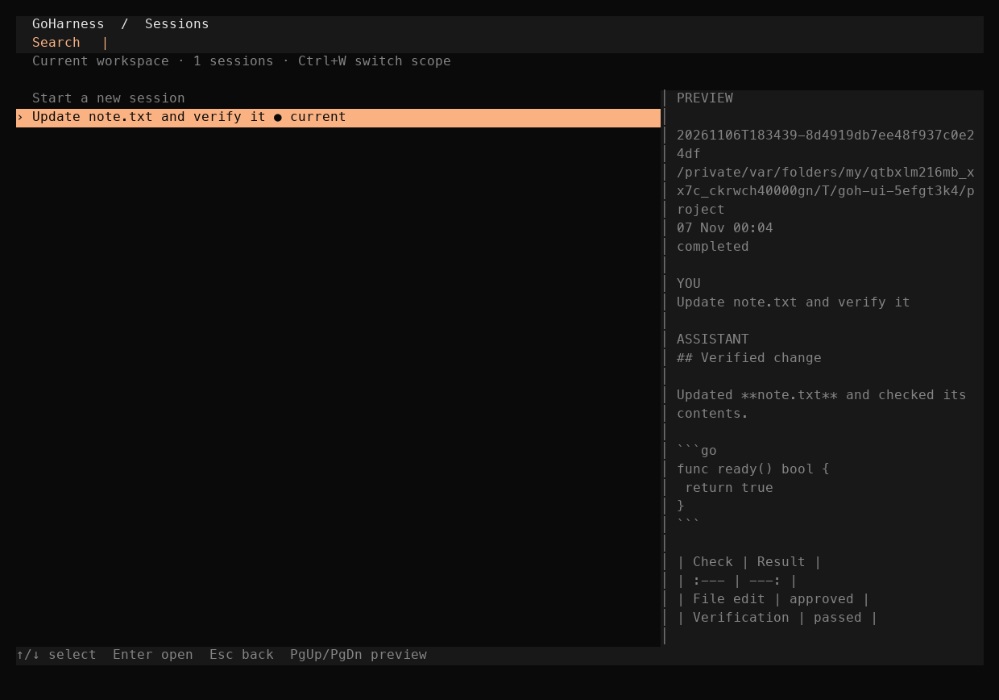

# GoHarness

A Go terminal coding agent with a chat-first interface, configurable model
providers, explicit tool approvals, and durable sessions.

The current local candidate is 1.0.0-rc.14. Public V1 release gates are tracked in
the [progress record](go-harness-reconstruction/PROGRESS.md).

- [Build, configure, and use GoHarness](go-harness-reconstruction/implementation/README.md)
- [Verification](go-harness-reconstruction/implementation/VERIFICATION.md)
- [Local measurements](go-harness-reconstruction/implementation/BENCHMARKS.md)
- [Implementation plan](IMPLEMENTATION_PLAN.md)
- [Source provenance](go-harness-reconstruction/ORIGIN_LEDGER.md)

Build from the implementation directory with a compatible Go toolchain.

~~~sh
cd go-harness-reconstruction/implementation
make VERSION=1.0.0-rc.14 build
./bin/goh
~~~

The executable is named goh. The development machine also has a zsh function
that opens GoHarness for bare go and delegates Go subcommands to the toolchain.
That shell customization is local to that machine.

Use /models to select a configured model profile, /agents to choose Build,
Plan, or a custom agent, and /new for a fresh conversation. Tab and Shift+Tab
cycle agents when the composer is empty.

Use /sessions to search saved conversations by title, ID, or workspace.
Ctrl+W switches between the current workspace and all workspaces. Wide terminals
show a saved-conversation preview beside the list. Tab opens the preview on
narrow terminals.

Use /status or Ctrl+G to inspect the local provider configuration, context
budget, session grants, and configured integrations. The dialog links to the
provider, model, agent, and settings screens.

Type `@` in the composer to find a project file. Use arrows to select and
Tab or Enter to insert its path. Send the draft when ready.

Use /timeline or Ctrl+T to search up to 200 retained prompts, preview one,
and recall it with Ctrl+R for editing before sending. Esc preserves your draft.

Use /fork to branch a full conversation or start a separate chat from before
an earlier turn. The selected prompt opens in the new composer for editing.

Git history starts with the existing RC8 implementation baseline. Subsequent
feature work is committed as separate milestones. Earlier implementation stages
are recorded in the progress document.
