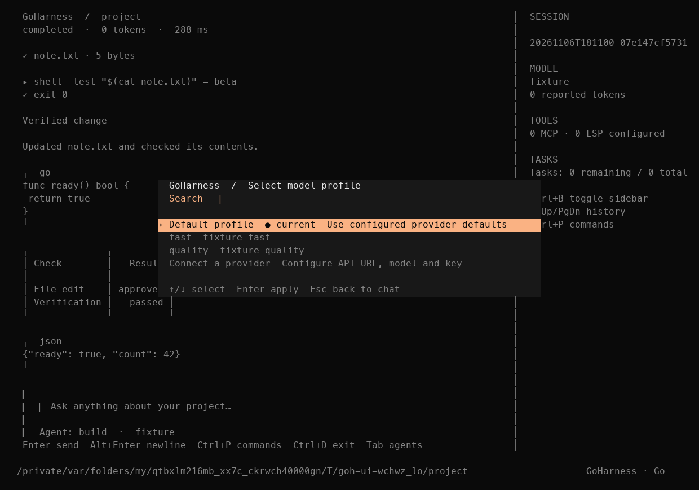

# GoHarness

A Go terminal coding agent with a chat-first interface, configurable model
providers, explicit tool approvals, and durable sessions.

The current local candidate is 1.0.0-rc.9. Public V1 release gates are tracked in
the [progress record](go-harness-reconstruction/PROGRESS.md).

- [Build, configure, and use GoHarness](go-harness-reconstruction/implementation/README.md)
- [Verification](go-harness-reconstruction/implementation/VERIFICATION.md)
- [Local measurements](go-harness-reconstruction/implementation/BENCHMARKS.md)
- [Implementation plan](IMPLEMENTATION_PLAN.md)
- [Source provenance](go-harness-reconstruction/ORIGIN_LEDGER.md)

Build from the implementation directory with a compatible Go toolchain.

~~~sh
cd go-harness-reconstruction/implementation
make VERSION=1.0.0-rc.9 build
./bin/goh
~~~

The executable is named goh. The development machine also has a zsh function
that opens GoHarness for bare go and delegates Go subcommands to the toolchain.
That shell customization is local to that machine.

Use /models to select a configured model profile, /agents to choose Build,
Plan, or a custom agent, and /new for a fresh conversation. Tab and Shift+Tab
cycle agents when the composer is empty.

Git history starts with the existing RC8 implementation baseline. Subsequent
feature work is committed as separate milestones. Earlier implementation stages
are recorded in the progress document.
