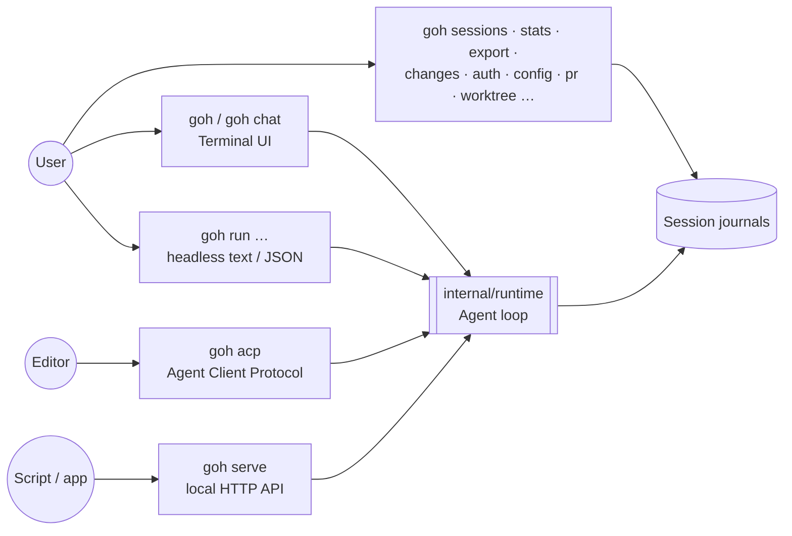
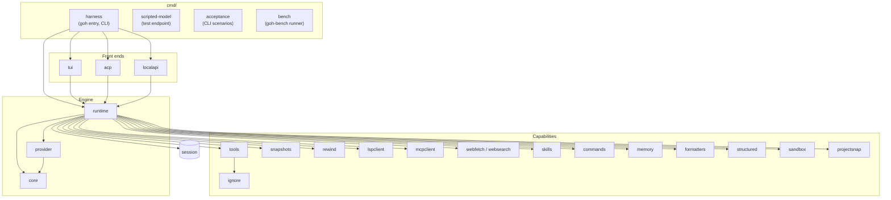
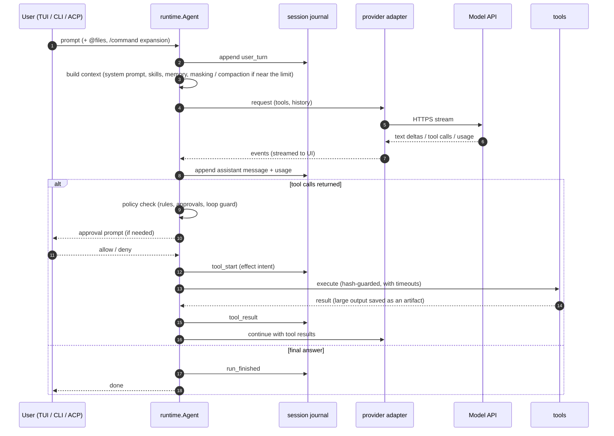
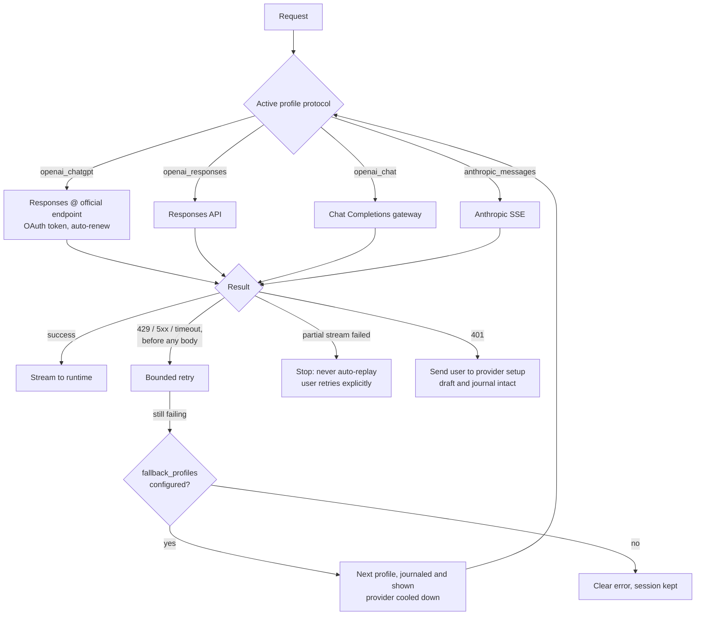
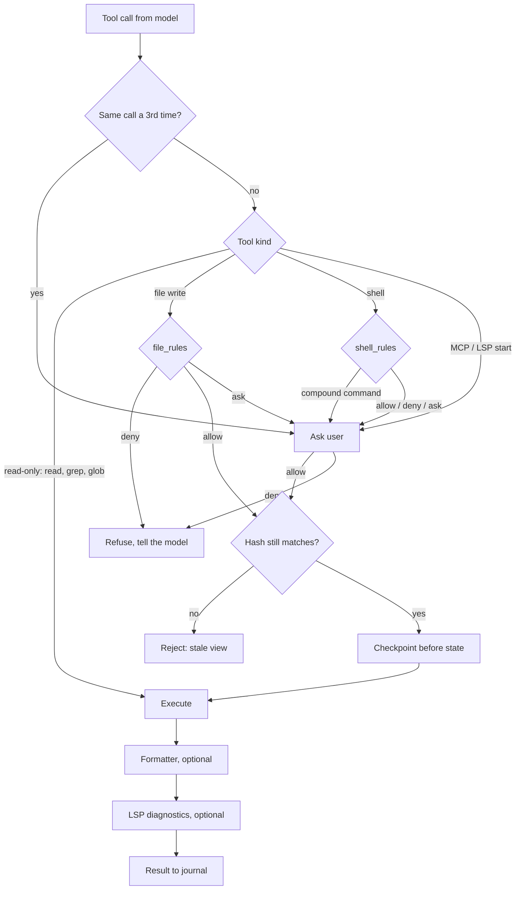
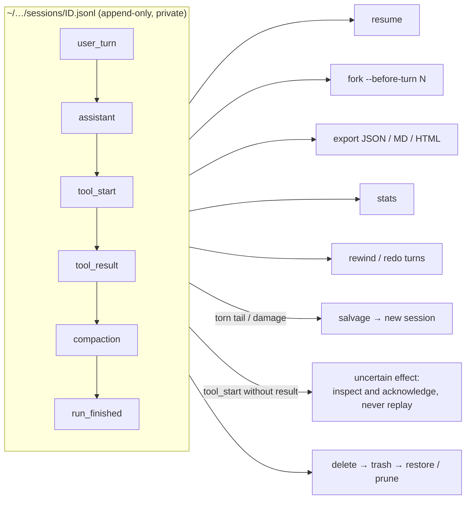
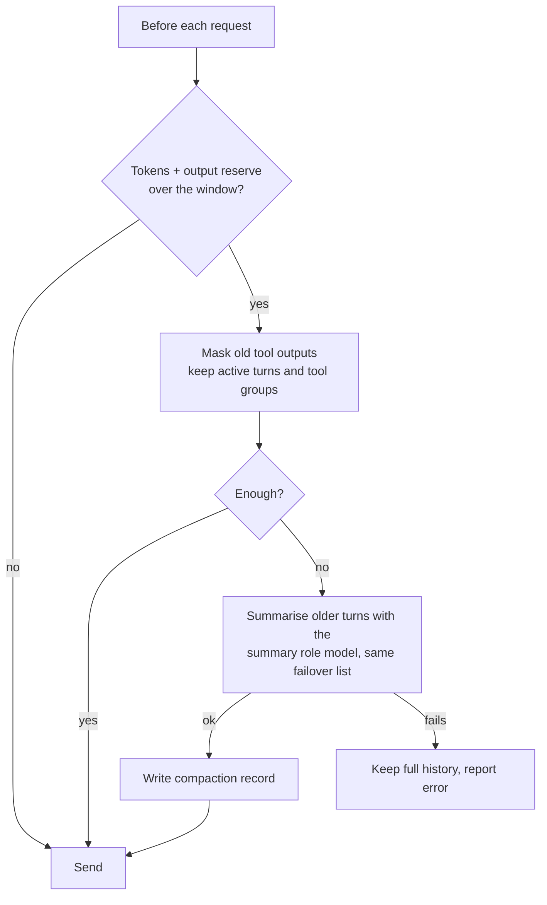
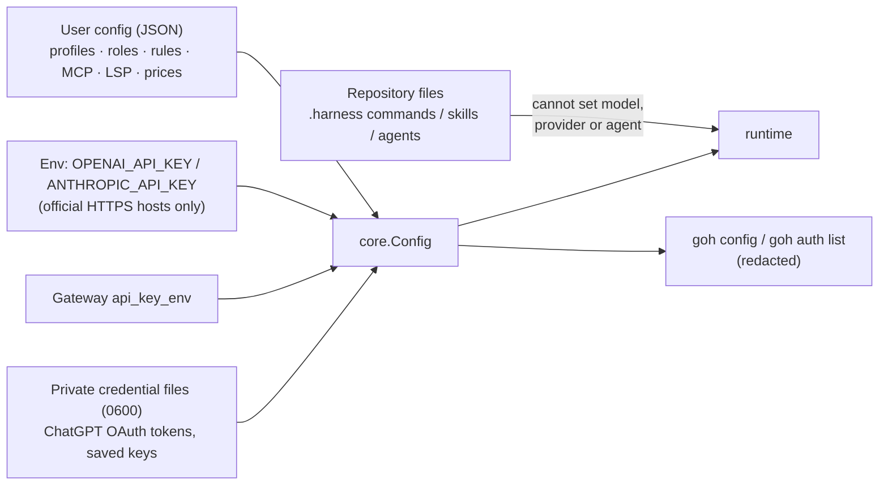
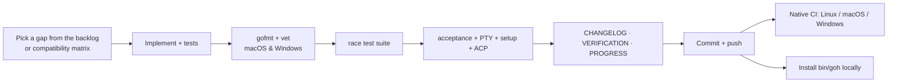

# GoHarness — Architecture and Status Overview

*Snapshot: 11 November 2026 · version `1.0.0-rc.168`*

GoHarness (`goh`) is an original coding assistant written in Go. Its behaviour was compared against
OpenCode v1.19.5 during development, but it is independently written and Apache‑2.0 licensed: the
reference sources under `research/` were used only to observe behaviour, never copied (see
`ORIGIN_LEDGER.md`).

It ships as a **single static binary** (CGO disabled) for macOS, Linux and Windows. It has a terminal UI, a
headless CLI, a local HTTP API, an editor protocol (ACP), and durable, recoverable sessions.

---

## 1. At a glance

| Metric | Value |
| --- | --- |
| Release candidates landed | 168 (RC1 → RC168), every one gated |
| Commits | 208 on `main` (Sanidhya14321/goh) |
| Code | 31,989 lines of product Go + 17,489 lines of tests, in 24 internal packages + 4 commands |
| CI | Ubuntu, macOS and Windows, native (`.github/workflows/ci.yml`) |
| Gates per milestone | gofmt · `go vet` (macOS + Windows) · `go test -race ./...` · CLI acceptance scenarios · PTY TUI suite · setup suite · ACP suite |
| Dependencies | Pinned; Bubble Tea stack for the TUI, MCP Go SDK, standard library for everything else |
| Releases published | **None yet**, by design (features first, then release) |

### Size by package (lines of Go: product / tests)

| Package | Product | Tests | Role |
| --- | ---: | ---: | --- |
| `internal/tui` | 5,923 | 2,546 | Bubble Tea terminal UI |
| `internal/runtime` | 4,308 | 5,306 | Agent loop, tool dispatch, approval policy, hooks, compaction, subagents, verification |
| `internal/tools` | 3,534 | 1,847 | File, patch, line-edit, search, repo map, shell, job and artifact tools |
| `cmd/harness` | 3,238 | 1,127 | `goh` entry point and all CLI subcommands |
| `internal/core` | 2,361 | 966 | Config, profiles, routing, ChatGPT OAuth, credential store |
| `internal/session` | 1,836 | 1,128 | Durable journal, export/import, salvage, stats |
| `internal/provider` | 1,776 | 1,130 | Anthropic, OpenAI Chat Completions, OpenAI Responses adapters |
| `internal/lspclient` | 1,109 | 393 | Language-server client (diagnostics, definitions) |
| `internal/mcpclient` | 1,025 | 645 | MCP over stdio and Streamable HTTP (tools, resources, prompts) |
| `internal/snapshots` | 914 | 375 | Per-file checkpoints with undo/redo |
| `internal/acp` | 702 | 60 | Agent Client Protocol for editors |
| `internal/webfetch` | 589 | 352 | Bounded, safe URL fetching |
| `cmd/bench` | 580 | 53 | `goh-bench` benchmark runner |
| `internal/sandbox` | 404 | 131 | Shell sandbox (sandbox-exec, Landlock, optional container) |
| `internal/projectsnap` | 218 | 119 | Whole-project Git snapshots |
| others | ~3,700 | ~1,300 | `skills`, `commands`, `localapi`, `memory`, `platform`, `rewind`, `structured`, `formatters`, `websearch`, `ignore`, `testutil`, `scripted-model`, `acceptance` |
| **Total** | **31,989** | **17,489** | |

---

## 2. What has been built

### 2.1 Surfaces (how you use it)

| Surface | Highlights |
| --- | --- |
| **Terminal UI** | Opens before setup. Command palette (Ctrl+P). `@file` fuzzy search, which honours `.gitignore`. Over 40 slash commands, including `/connect`, `/models`, `/sessions`, `/timeline`, `/fork`, `/undo`, `/redo`, `/changes`, `/jobs`, `/todos`, `/status`, `/find`, `/copy`, `/export`, `/theme`, `/editor` and `/effort`. Also a queued-prompt composer, context meter, configurable keybinds, themes, Ctrl+Z suspend, and wide and compact layouts. |
| **Headless CLI** | `goh run` gives text or JSON events. Piped stdin works (`cat log \| goh run explain`). Uses the same journal and approvals as the TUI. |
| **Session CLI** | `list` (json/table/ids, `--project`), `preview`, `show`, `export` (JSON/Markdown/HTML), `import`, `fork --before-turn`, `salvage`, `rename`, `delete`/`restore` (trash), `prune --days`. |
| **Workflow helpers** | `goh pr N` runs `gh pr checkout` and opens the UI. `goh worktree NAME` opens the UI in an isolated git worktree. `goh changes` shows file checkpoints. `goh stats` shows tokens, cost estimates and per-tool calls and failures. |
| **Admin** | `goh auth login/status/models/logout/list`, `goh config` (secrets redacted), `goh doctor`, `goh completion bash/zsh/fish`, `goh uninstall` (lists first; `--yes` to act). |
| **Integrations** | ACP for editors (Zed and similar). `goh serve` local API. MCP servers over stdio and remote Streamable HTTP. LSP language servers (auto-detected when enabled). Formatters (auto-detected when enabled). |

### 2.2 Model providers

| Protocol | Use |
| --- | --- |
| `openai_chatgpt` | **Continue with ChatGPT**: official OAuth sign-in (PKCE, ID-token checks, renewal), bound to the official Responses endpoint |
| `openai_responses` | OpenAI Responses API with an API key |
| `openai_chat` | Any OpenAI-compatible Chat Completions gateway (Ollama, OpenRouter, vLLM and others), with JSON-reply and `stream_options` fallbacks |
| `anthropic_messages` | Anthropic SSE streaming, with extended thinking (`thinking_budget`) |

Multiple named **profiles**, **model roles** (a separate model for summaries and titles), ordered
**fallback profiles** with per-provider cooldowns, `reasoning_effort` and context-window settings.

### 2.3 Tools available to the model

| Group | Tools |
| --- | --- |
| Files | `list_files`, `read_file` (line numbers + SHA-256), `write_file`, `edit_file`, `apply_patch` (multi-file Add/Update/Delete/Move) |
| Search | `glob`, `grep`, `repo_map` (declaration map), `lsp` (diagnostics, definitions) |
| Shell | `shell` (approved, timeouts, process-group kill), `job_start` / `job_output` / `job_stop` (background jobs) |
| Agent | `task` (subagents), `todowrite`, `question` (ask the user), `skill`, `memory_recall` |
| Web | `webfetch`, `websearch` |
| Recovery | `snapshot_list` / `_diff` / `_undo` / `_redo`, `read_artifact` (retained large outputs), `formatter_status` |
| External | Any tool from configured MCP servers (namespaced, approval-gated) |

---

## 3. What makes it different (USPs)

1. **Write-ahead safety: every edit is guarded by a hash.** `edit_file`, `write_file` and `apply_patch`
   require the file's current SHA-256. A stale view of a file can never overwrite someone else's change.
2. **Never replays an uncertain effect.** If a run is interrupted mid-tool, the journal records an
   *uncertain effect*. GoHarness refuses to re-run it automatically and asks the user to inspect and
   acknowledge it. Partial model streams are never silently retried.
3. **Durable, salvageable sessions.** The append-only JSONL journal is the single source of truth. A torn
   or damaged journal can be **salvaged** into a new session. Sessions can be forked before any turn, exported
   (JSON, Markdown or HTML), imported on another machine with project relocation, trashed and restored.
4. **Credential discipline.** `OPENAI_API_KEY` and `ANTHROPIC_API_KEY` are sent only to official HTTPS hosts. Gateways
   use their own key variable. Failover to another provider happens **only** through an explicit
   `fallback_profiles` list. Credentials sit in private (0600) files. `goh config` and `goh auth list` never
   print a secret.
5. **Approvals that cannot be widened by accident.** `shell_rules` and `file_rules` allow, deny or ask.
   "Allow" never covers a compound shell command. Repository files cannot pick the agent or model. A third
   identical tool call needs fresh approval (loop guard).
6. **Three layers of undo.** Per-file checkpoints (content-addressed, no Git required, binary-safe),
   whole-project Git snapshots that also cover shell changes, **plus** turn-level rewind/redo of the
   conversation.
7. **One binary with no runtime.** No Node and no Bun. It is pure Go with CGO off, cross-compiled for six
   OS/architecture targets, and starts instantly.
8. **Recovery-first UX.** Chat opens even when setup is broken. A 401 sends the user to provider setup with
   the draft kept. A failing MCP or LSP server is stopped and the run continues. Orphaned background jobs are
   found and stopped on the next start.
9. **Deterministic test harness.** `cmd/scripted-model` is a local scripted model endpoint. Every gate runs
   without live keys, including real PTY tests of the TUI and real `clangd` LSP runs.

---

## 4. Architecture

### 4.1 Package map

### 4.2 Lifecycle of one prompt

### 4.3 Provider routing and failover

### 4.4 Approval and safety pipeline for a tool call

### 4.5 Session journal and recovery

### 4.6 Context management

### 4.7 Configuration and credentials

---

## 5. Engineering process

Evidence for each RC is in `docs/VERIFICATION.md`. Recovery gaps by area are tracked in
`docs/END_TO_END_AUDIT.md`.

---

## 6. Known gaps and open decisions

| Area | Status |
| --- | --- |
| **Release** | Release scripts and checksum-verifying installers exist; **nothing published yet** (needs the owner's go-ahead). There is no `goh upgrade` command. |
| **Credentials** | OS keychain storage and multiple ChatGPT accounts are not done. |
| **Plugins** | Custom tool plugins that run repository code: not done (security decision). |
| **Sharing** | Session share/upload: not done (it would upload conversations). |
| **MCP OAuth** | Not done; needs a real OAuth MCP server to test against. |
| **TUI ↔ server** | Attaching the TUI to a running `goh serve` is not done. |
| **Live-only checks** | The ChatGPT path is exercised by live benchmark runs (`docs/bench/`). Anthropic extended thinking and real multi-provider failover have fixture tests only. |
| **Sandbox** | Linux Landlock cannot hide files denied by `file_rules` from a sandboxed shell (macOS can); documented limit. |
