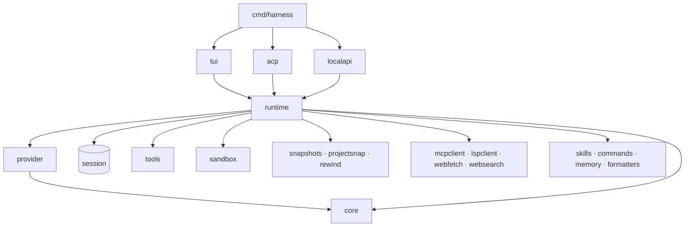
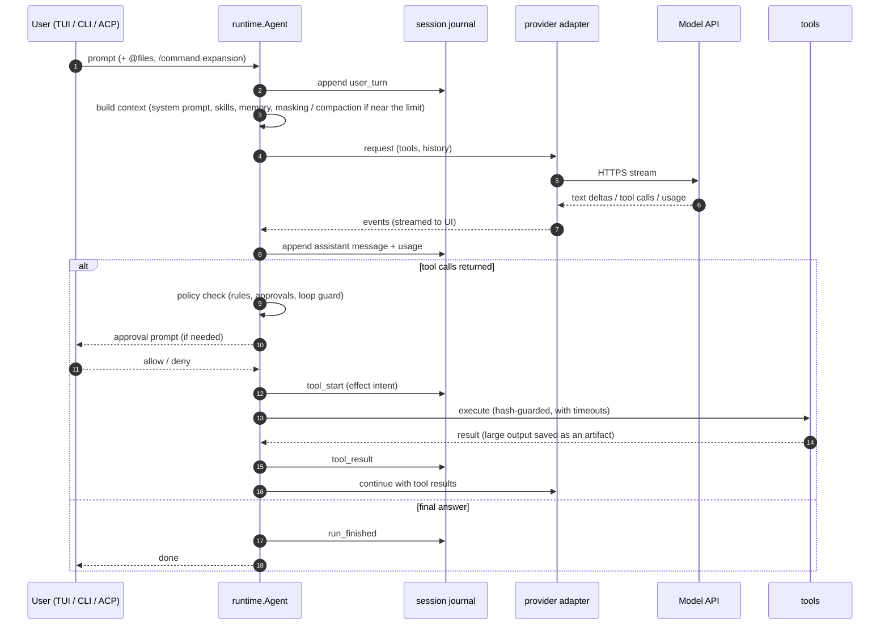
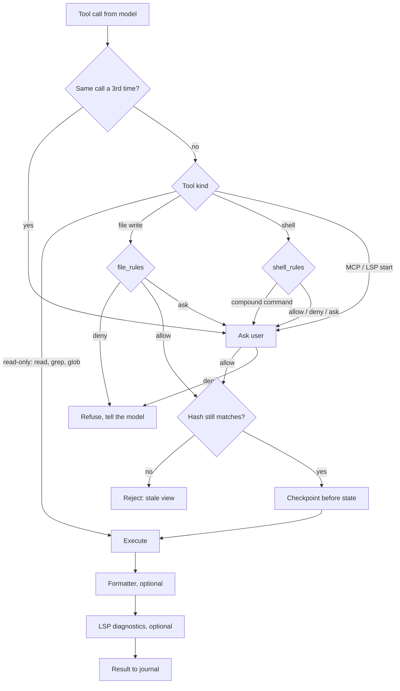
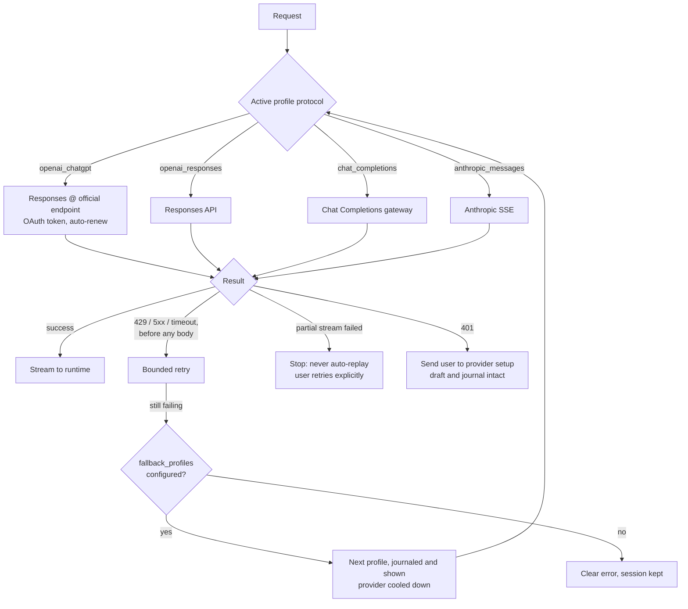
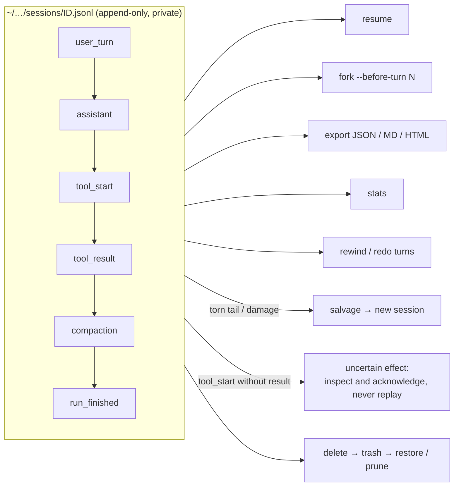
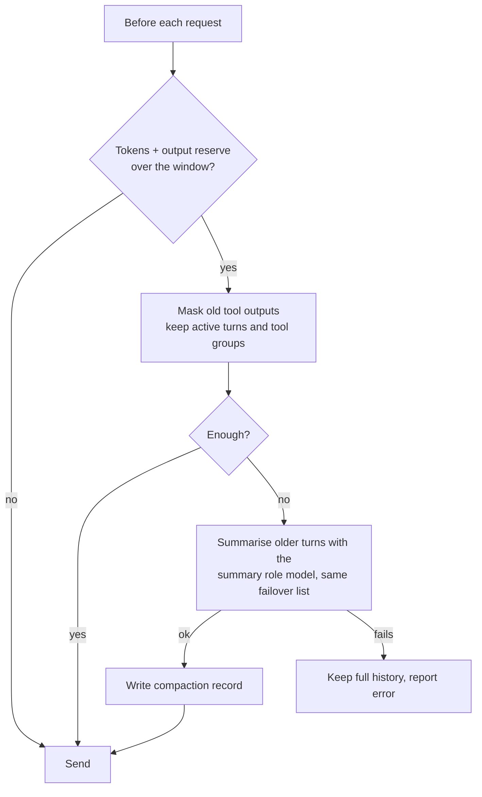
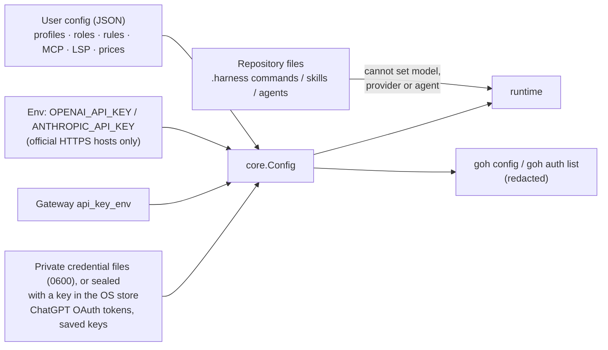

# Architecture

GoHarness (`goh`) is one statically linked Go binary (CGO disabled) for macOS, Linux and Windows.
All of its interfaces drive the same agent runtime, and every conversation is an append-only
journal that is the single source of truth for resume, fork, export and recovery.

For what each feature does, see the [user guide](USER_GUIDE.md). For why it was built this way,
see [design decisions](development/DESIGN_DECISIONS.md).

## Repository layout

| Path | Contents |
| --- | --- |
| `cmd/harness` | The `goh` binary: CLI subcommands, launcher, provider setup flows |
| `cmd/scripted-model` | Local model endpoint that replays scripted replies; used by every test |
| `cmd/acceptance` | CLI acceptance scenarios against the compiled binary |
| `cmd/bench` | `goh-bench`, the benchmark runner (tasks in `bench/`) |
| `internal/` | All product packages (below) |
| `scripts/` | Installers, release script, and `e2e/` terminal test suites |
| `docs/` | User guide, architecture, benchmarks, development records; `plan/` holds the original plan and behaviour specs |
| `licenses/`, `THIRD_PARTY_NOTICES` | Exact third-party license texts |
| `research/` | Local reference material, mostly not tracked; never copied into product code ([origin ledger](ORIGIN_LEDGER.md)) |

## Packages

| Group | Package | Role |
| --- | --- | --- |
| Front ends | `tui` | Bubble Tea terminal UI; renders the runtime's event stream and owns no agent state |
| | `acp` | Agent Client Protocol v1 over stdio, for editors |
| | `localapi`, `remote` | `goh serve` loopback HTTP API, and the client `goh attach` uses |
| Engine | `runtime` | The agent loop: prompts, tool dispatch, permissions, hooks, compaction, subagents, verification |
| | `provider` | Chat Completions, Responses (including the ChatGPT sign-in) and Anthropic Messages adapters |
| | `core` | Configuration, providers and routing, ChatGPT OAuth, credential storage, shared types |
| | `session` | Crash-recoverable JSONL journal, export and import, salvage, statistics |
| Tools | `tools` | File reads and exact edits, patches, glob and grep, shell, background jobs, repository map |
| | `snapshots`, `projectsnap`, `rewind` | Per-file checkpoints, whole-project Git snapshots, turn-level undo and redo |
| | `sandbox` | Shell confinement: sandbox-exec on macOS, Landlock on Linux |
| | `mcpclient`, `lspclient` | MCP servers (stdio and Streamable HTTP), language servers |
| | `webfetch`, `websearch` | Bounded URL fetching with private-address refusal; SearXNG-compatible search |
| | `skills`, `commands`, `memory`, `formatters` | Markdown skills, custom slash commands, project notes, formatters |
| Support | `ignore`, `structured`, `platform`, `secretstore`, `testutil` | `.gitignore` matching, child-result validation, OS differences, OS keychain, test fixtures |

## One prompt, end to end

Large tool output is kept as an artifact and only a bounded preview enters the context; the model
can page through the rest with `read_artifact`.

## Tool calls and safety

Enforcement happens outside the model. Every tool call passes the same pipeline whether it came
from the TUI, the CLI, the API or an editor.

- **Hash-guarded edits.** `edit_file`, `write_file` and `apply_patch` need the file's current
  SHA-256, so a stale view never overwrites a newer change.
- **Scoped approvals.** "Allow for this session" covers a command prefix, a web origin or a tool,
  never a compound shell command or one that runs code given as an argument.
- **Filtered environment.** Shell commands get a scrubbed environment without provider secrets.
- **Sandbox (opt-in, `sandbox.enabled`).** Shell commands may write only inside the project and
  temporary folders, never `.git/hooks` or `.git/config`, and have no network unless allowed.
- **Loop guard.** A third identical call needs fresh approval.
- **Repository files** (custom commands, skills, agents) cannot choose the provider, model or agent.

## Providers

`OPENAI_API_KEY` and `ANTHROPIC_API_KEY` are sent only to the official HTTPS hosts. Failover to
another provider happens only through an explicit `fallback_profiles` list, and a partially
streamed reply is never replayed automatically.

## Sessions and recovery

Every record is fsynced before the runtime continues. A tool call that started but has no result
is an *uncertain effect*: it is shown to the user and never re-run automatically.

## Context management

## Configuration and credentials

## Terminal UI structure

An interactive session (`goh`, `goh chat`, `goh attach`, `goh setup`, `goh settings`,
`goh providers`) runs one Bubble Tea program, the host (`internal/tui/host.go`). The command
palette, theme, changes, copy, jobs, timeline and approval views are overlays inside the chat.
Everything else (provider manager, connect, model and agent pickers, settings, project and
session pickers, and the chat itself after a navigation) is a screen the host shows in turn:
the launcher keeps its blocking style, `runProgram` hands each screen to the host and waits
until it quits. So the terminal never leaves the alternate screen between screens, keys typed
during a change of screen go to the next one, and a dialog over the chat is drawn over the live
chat, which reflows on resize. Messages from a screen's timers and requests are tagged with that
screen and dropped once it closes. A prompt that must read standard input directly (recovering a
damaged session) runs through `tui.Suspended`, which hands the terminal back meanwhile. Outside a
host, `runProgram` still runs a standalone program that closes only once typing pauses and
replays keys typed meanwhile into the next screen.
